# Cautiva Spa · Unidad 2: Catálogo UML, patrones e integración

Nov 1, 2026 · @Tineo

La Unidad 2 convierte la arquitectura de la Unidad 1 (monolito modular Spring Boot + Spring Modulith, SPA Angular, Oracle) en un catálogo UML trazable: dominio, análisis BCE, clases, diagramas dinámicos, APIs e integración. Esta versión está alineada con el **diccionario de datos v5 del 27/10/2026** (herencia PERSONA y COMPROBANTE, catálogo TIPO\_DOCUMENTO y 12 tablas retiradas) con su revisión del 01/11/2026, y con la matriz del 01/11/2026; la arquitectura de la Unidad 1 no cambia. Completa las **seis secciones**.

**Fuentes de verdad usadas (y solo estas).**

| Fuente | Contenido que se usa | Volumen |
| --- | --- | --- |
| Caso de negocio Cautiva Spa E.I.R.L. | Roles, procesos BUC01–BUC10, reglas principales, fases 1–3 | 6 roles, 10 procesos |
| Matriz de requerimientos (01/11/2026) | RF, CUS, reglas de negocio, restricciones, RNF, priorización y trazabilidad RF→CUS; el 27/10/2026 cambiaron RN45 (catálogo de tipos de documento) y el texto de RF03 y RN16, sin cambiar los puntajes; el 01/11/2026 se agregaron RF103 a CUS26 y RF106 a CUS22 | 107 RF, 67 CUS, 47 RN, 31 RES, 35 RNF |
| Diccionario de datos v5 (Oracle, 27/10/2026) | Tablas, columnas, PK, FK, UNIQUE, CHECK, jerarquías EER, relaciones, trazabilidad CUS→tablas y 217 cambios respecto al v4 (los cambios 214 a 217 del 01/11/2026 cierran O-15 a O-17); scripts v5 probados en CAUTIVA5 (144 pruebas OK) | 55 tablas, 423 columnas, 121 FK, 2 jerarquías |
| Arquitectura de la Unidad 1 (docs 00–05) | Módulos `seguridad`, `sedes`, `catalogo`, `inventario`, `personal`, `agenda`, `ventas`, `pagos`, `caja`, `reportes` y el núcleo `comun`; componentes C3 y clases C4 (sin cambios por el v5) | 10 módulos + núcleo |

**Convenciones de este documento.**

- Una clase de dominio se llama como su tabla en PascalCase (`VENTA_DETALLE` → `VentaDetalle`) y cada atributo como su columna en camelCase (`id_venta` → `idVenta`). No hay clases de entidad sin tabla.
- Los objetos de valor no crean tablas: se guardan en las columnas que ya existen (`@Embeddable` o `AttributeConverter`).
- Toda regla se cita con su código (RN, RF, RES) y, cuando Oracle la hace cumplir, con el nombre de su CONSTRAINT o de su trigger del script v5.
- En el análisis y en las secuencias se usa la nomenclatura de la cátedra (`IGU_`, `ControladorX`, `ServicioX`, `RepositorioX`, `GestorX`, `ManejadorX`); la tabla 2.2 da su equivalente en el código de la Unidad 1 (`XController`, `XService`, `XRepository`).
- Los diagramas de secuencia y de clases están en el archivo draw.io «Diagramas de secuencia y clase» (71 páginas), con el formato del ejemplo del profesor (actor → Navegador → IGU\_ → Controlador → Servicio → Repositorio → Entidad → BD). Desde el 23/10/2026, por observación del docente, cada CUS se nombra con un verbo concreto y un solo objeto del dominio, sin «Gestionar»: los 22 CUS anteriores se separaron en 67 (la equivalencia está en la columna «Venía de» del índice del draw.io y en la hoja «Cambios CUS 23-10» del diccionario).
- Desde el 27/10/2026 el modelo sigue el diccionario v5: 64 CUS tienen realización y CUS17, CUS27 y CUS67 (Won't Have) quedan sin realización porque el v5 retiró sus tablas. Cuando Oracle ya hace un efecto con un trigger (por ejemplo TRG\_VENTA\_EFECTOS al cerrar o anular una venta), la secuencia lo muestra en el mensaje a la BD y el backend no lo repite.

## Sección 1 · Descubrimiento del dominio y DDD estratégico

El dominio de Cautiva Spa se organiza en 10 módulos y 34 agregados; el proceso core Reserva → Atención → Cobro vive en cuatro módulos core (`agenda`, `ventas`, `pagos`, `caja`) y su raíz transaccional es **Venta**.

### 1.1 Lenguaje ubicuo

Estos términos se usan igual en la conversación con la dueña, en los casos de uso, en el código Java y en Oracle. Dos palabras del negocio tienen doble sentido y se separan a propósito: **adelanto** (de reserva o de sueldo) y **cliente** (clienta registrada o cliente de paso).

| Término | Significado en el negocio | Se guarda en | Regla o RF |
| --- | --- | --- | --- |
| Clienta | Persona registrada con nombre y teléfono único; su ficha reúne historial, citas, paquetes y saldo a favor. Es un subtipo de PERSONA | PERSONA (datos comunes) + CLIENTE (subtipo, mismo id) | RN01, RF01–RF03 |
| Persona | Supertipo de clienta, personal y proveedor: nombres o razón social, documento, teléfono, correo y verificación, una sola vez. Una misma persona puede ser clienta y personal a la vez | PERSONA | RN01, RN45 |
| Tipo de documento | DNI, carnet de extranjería, RUC, pasaporte o cédula diplomática (Catálogo 06 de SUNAT); fija la longitud y si se consulta en APISPERU | TIPO\_DOCUMENTO | RN45, RF97–RF99 |
| Cliente de paso | Quien se atiende sin registrarse, solo con su nombre (por ejemplo, un corte de caballero) | ATENCION.nombre\_cliente\_paso con id\_cliente nulo; VENTA.id\_cliente nulo | RN35, RF19 |
| Consentimiento | Autorización de la clienta para tratar sus datos, con fecha, antes de guardar la ficha | CLIENTE.fecha\_consentimiento, acepta\_comunicaciones | RN27, RF04 |
| Consulta DNI/RUC | Petición al servicio de APISPERU que devuelve nombres (DNI) o razón social, estado y condición (RUC); solo para los tipos de documento con consulta\_api = S. No se guarda una bitácora: el resultado queda en la ficha | TIPO\_DOCUMENTO.consulta\_api; PERSONA.origen\_datos, fecha\_verificacion | RN45, RF97, RF98 |
| Ficha verificada / ingresada a mano | Origen de los datos de una persona: VERIFICADO si se completaron con la consulta del DNI o del RUC; MANUAL si la consulta falló, el documento no existe o es de otro tipo | PERSONA.origen\_datos, fecha\_verificacion | RN45, RF99 |
| Especialista técnica | Personal que brinda servicios en una o varias áreas y limpia su espacio | PERSONA + PERSONAL (cargo ESPECIALISTA\_TECNICA), PERSONAL\_AREA | RF51 |
| Línea | Salón o Spa; agrupa áreas. Es un atributo del área, no una tabla | AREA.linea (SALON o SPA) | RF68, RF83 |
| Área | Una de las cinco especialidades: Peluquería y Estilismo, Manicura y Pedicura, Depilación (Salón); Cuidado Facial y Cabina Spa (Spa); los masajes son servicios de Cabina Spa | AREA | RF83 |
| Servicio | Lo que se ofrece en un área, con duración de referencia y el tipo de recurso que ocupa | SERVICIO (tipo\_recurso) | RF06, RF83 |
| Variante | Versión de un servicio con precio fijo propio (corte normal, degradado) | VARIANTE\_SERVICIO | RN40 |
| Duración de referencia | Minutos típicos de un servicio; no es el tiempo real | SERVICIO.duracion\_ref\_min | RN41 |
| Tiempo declarado | Minutos exactos que la especialista indica al agendar o al iniciar la atención | CITA.duracion\_min, ATENCION.tiempo\_declarado\_min | RN41, RF13 |
| Recurso | Sillón, estación, camilla, cabina u otro espacio físico de una sede | RECURSO | RES27, RF85 |
| Tiempo de limpieza | Minutos (0–30) que el recurso queda bloqueado tras cada servicio | RECURSO.minutos\_limpieza | RN03, RF14 |
| Cita | Reserva de clienta, variante, especialista, recurso, inicio y duración, sin cruces | CITA | RN02, RF07 |
| Recordatorio | Aviso por WhatsApp antes de la cita, uno por cita | CITA.fecha\_recordatorio | RF89, RN27 |
| Adelanto de reserva | Pago que asegura la cita: en efectivo con la caja del día, o digital por enlace de pago; el digital cuenta solo cuando la pasarela lo aprueba | CITA.adelanto\_monto, id\_medio\_pago, fecha\_adelanto, id\_caja; TRANSACCION\_PASARELA (canal LINK) | RN04, RF10, RF104 |
| Enlace de pago | URL de Izipay con vencimiento que la recepcionista comparte por WhatsApp para cobrar el adelanto | TRANSACCION\_PASARELA.enlace\_pago, fecha\_expiracion | RF104, RES08 |
| Reprogramación | Mover una cita; el adelanto pasa a la nueva cita | CITA.id\_cita\_origen, estado REPROGRAMADA | RN05, RF12 |
| Cancelación | Anular una cita con motivo; el adelanto se vuelve saldo a favor | CITA.estado CANCELADA, motivo\_cancelacion | RN05, RF12 |
| Saldo a favor | Dinero de la clienta que no vence; nace de una cita cancelada o de una venta anulada que la clienta elige no devolver, y se calcula con sus movimientos | SALDO\_FAVOR\_MOV (ABONO, USO) | RN05, RN44, RF25 |
| Lista de espera | Clienta anotada cuando no hay capacidad en la hora pedida | LISTA\_ESPERA | RF09 |
| Atención | Servicio realmente prestado, con o sin cita; base del cobro y de la comisión | ATENCION | RN34, RF13, RF17 |
| Recomendación | Producto que la especialista sugiere durante una atención; si la clienta lo compra, la línea de venta guarda a esa especialista | RECOMENDACION\_PRODUCTO | RF16, RF38 |
| Paquete | Conjunto de servicios con número de sesiones que se consume en varias visitas | PAQUETE (tipo PAQUETE), PAQUETE\_SERVICIO | RN36, RF23 |
| Membresía | Plan de spa que se maneja por sesiones | PAQUETE (tipo MEMBRESIA) | RN37, RF91 |
| Sesión consumida | Uso de una sesión de un paquete en una atención; no se cobra ni genera comisión. Se cuenta, no se guarda aparte | ATENCION.id\_cliente\_paquete; vista V\_SESIONES\_PAQUETE | RN36, RN38, RF24 |
| Promoción o descuento | Rebaja con vigencia que crea solo la dueña; aplica solo a servicios | PROMOCION, PROMOCION\_SERVICIO | RN25, RF84 |
| Venta | Cobro de servicios, productos o paquetes; nace ABIERTA, se CIERRA o se ANULA, nunca se borra | VENTA | RN10–RN12 |
| Línea de venta | Renglón de la venta: un servicio, un producto o un paquete | VENTA\_DETALLE | RF21, RF38 |
| Medio de pago | Efectivo, Yape, Plin o tarjeta; indica si se cobra por la pasarela (el efectivo nunca) | MEDIO\_PAGO (usa\_pasarela), VENTA\_PAGO | RN11, RN42, RF26, RF88 |
| Transacción de la pasarela | Cobro o devolución procesado por Izipay (QR, enlace, POS o API); solo la APROBADA cuenta como pagada; guarda comisión y fecha de abono, nunca datos de tarjeta | TRANSACCION\_PASARELA; VENTA\_PAGO.id\_transaccion | RN42, RN43, RF103, RF105 |
| Comprobante electrónico | Boleta, factura o nota de crédito que el sistema emite y envía a SUNAT por medio de APISPERU, firmada con el CDT de la empresa. Es el supertipo de la jerarquía COMPROBANTE | COMPROBANTE (tipo BOLETA, FACTURA, NC\_BOLETA o NC\_FACTURA) | RN07, RN10, RES11, RF27 |
| Serie de comprobante | B001, F001, BC01 o FC01 por sede con su último número; Oracle asigna serie y correlativo, nadie los digita | SERIE\_COMPROBANTE | RN47, RF107 |
| Estado SUNAT y CDR | PENDIENTE, ENVIADO, ACEPTADO, OBSERVADO o RECHAZADO, con código y descripción de la respuesta, XML firmado y constancia de recepción | COMPROBANTE (estado\_sunat, codigo\_respuesta, ruta\_xml, ruta\_cdr), también para las notas de crédito | RN46, RN47, RF100 |
| Comprobante pendiente de envío | Comprobante que no llegó a SUNAT porque el proveedor no respondió; la venta se cierra y el sistema lo reenvía dentro de 3 días | COMPROBANTE.estado\_sunat PENDIENTE, intentos\_envio | RN46, RF101 |
| Nota de crédito electrónica | Comprobante que el sistema emite para anular una venta, con motivo, código de motivo SUNAT, forma de devolución y autorizaciones; subtipo de COMPROBANTE | COMPROBANTE (NC\_BOLETA o NC\_FACTURA) + NOTA\_CREDITO (subtipo, mismo id) | RN12, RN32, RN44, RF33 |
| Devolución | Reintegro de una venta anulada por el mismo medio (pasarela o caja) o como saldo a favor si la clienta lo elige | TRANSACCION\_PASARELA (DEVOLUCION), SALDO\_FAVOR\_MOV | RN44, RF106 |
| Proforma | Cotización imprimible sin valor tributario; se arma con el catálogo y no se guarda | No se guarda (lee VARIANTE\_SERVICIO, PAQUETE, PROMOCION) | RN09, RF31 |
| Comisión | Porcentaje sobre servicios cobrados que define solo la dueña | PERSONAL.porcentaje\_comision, VENTA\_DETALLE.monto\_comision | RN38, RF58 |
| Caja del día | Registro diario por sede: apertura, egresos, arqueo y cierre | CAJA, CAJA\_EGRESO, CAJA\_ARQUEO | RN30, RF62 |
| Arqueo | Comparación de lo esperado con lo contado por cada medio, también el efectivo; el digital se toma de la pasarela | CAJA\_ARQUEO (V\_CAJA\_ESPERADO) | RN30, RF63–RF65 |
| Conciliación | Cruce mensual de las ventas con los comprobantes aceptados por SUNAT (y sus notas de crédito) y con las transacciones, comisiones y abonos de la pasarela | CONCILIACION, CONCILIACION\_ITEM | RN31, RF75, RF105 |
| Producto de venta / insumo | Producto que se vende a la clienta o que se usa en los servicios | PRODUCTO.tipo\_uso | RN13, RF44 |
| Stock mínimo | Cantidad por sede que dispara la alerta de reposición | INVENTARIO\_SEDE.stock\_minimo | RN16, RF47 |
| Kardex | Historial de entradas, salidas y ajustes con fecha, cantidad, saldo y usuario | MOVIMIENTO\_KARDEX | RN18, RF50 |
| Requerimiento de compra | Pedido interno numerado con prioridad y varios productos, que aprueba la dueña | REQUERIMIENTO\_COMPRA, REQUERIMIENTO\_DETALLE | RN19, RF41 |
| Compra | Ingreso de mercadería con proveedor y número de factura | COMPRA, COMPRA\_DETALLE | RN19, RF43 |
| Proveedor | Persona jurídica con RUC que vende productos e insumos, con su persona de contacto | PERSONA + PROVEEDOR (contacto) | RF40, RF98 |
| Esquema de pago | Fijo, comisión o mixto de cada persona | PERSONAL.modalidad\_pago | RN20, RF52 |
| Asistencia | Marcas diarias de entrada, almuerzo y salida | ASISTENCIA | RN23, RF54 |
| Adelanto de sueldo | Dinero entregado al personal y descontado en la planilla del mes | ADELANTO | RN21, RF57 |
| Planilla | Cálculo mensual de pagos con faltas, tardanzas, adelantos y comisiones | PLANILLA, PLANILLA\_DETALLE | RF59 |
| Usuario y rol | Cuenta de una persona del personal con un solo rol; solo la dueña los crea y ajusta los permisos de cada rol | USUARIO, ROL, ROL\_PERMISO, PERMISO | RN39, RF81 |
| Parámetro | Valor del negocio que cambia sin tocar código (IGV 0 %, RMV, S/700, plazo de envío de 3 días, vigencia del enlace de pago) | PARAMETRO | BUC09 |
| Incidente de seguridad | Vulneración de datos personales que se avisa a la autoridad en 48 horas | INCIDENTE\_SEGURIDAD | RN28, RF96 |
| Sede | Local del negocio; todo dato de operación pertenece a una | SEDE | RN26, RES23 |

### 1.2 Entidades: clasificación táctica de las 55 tablas

Las 55 tablas del diccionario v5 se reparten en 34 raíces de agregado, 14 entidades internas y 7 tablas de clave compuesta; ninguna queda fuera de un agregado. Una **entidad** tiene identidad propia (su PK) y ciclo de vida (su columna `estado`); un **registro inmutable** solo se inserta y nunca se edita ni se borra. El v5 agrega PERSONA (supertipo de CLIENTE, PERSONAL y PROVEEDOR) y TIPO\_DOCUMENTO, ambas en `seguridad`, convierte NOTA\_CREDITO en subtipo de COMPROBANTE y retira 12 tablas: SEDE\_CANAL, PEDIDO, PEDIDO\_DETALLE, LINEA, SERVICIO\_RECURSO, CONSUMO\_SESION, HISTORIAL\_PRECIO, CORRECCION\_ASISTENCIA, RECORDATORIO, CONSULTA\_DOCUMENTO, PROFORMA y PROFORMA\_DETALLE (SOLICITUD\_REPOSICION pasa a llamarse REQUERIMIENTO\_DETALLE).

| Tabla Oracle | Módulo | Rol táctico | Agregado | Identidad (PK) | Ciclo de vida (CHECK de estado) |
| --- | --- | --- | --- | --- | --- |
| USUARIO | seguridad | Raíz | Usuario | id\_usuario | ACTIVO, INACTIVO, BLOQUEADO |
| ROL | seguridad | Raíz | Rol | id\_rol | ACTIVO, INACTIVO |
| ROL\_PERMISO | seguridad | Asociativa interna | Rol | (id\_rol, id\_permiso) | — |
| PERMISO | seguridad | Raíz de catálogo | Permiso | id\_permiso | — |
| AUDITORIA | seguridad | Raíz, registro inmutable | Auditoria | id\_auditoria | — |
| PARAMETRO | seguridad | Raíz | Parametro | id\_parametro | vigencia por fecha\_vigencia |
| TIPO\_DOCUMENTO | seguridad | Raíz de catálogo (nueva v5) | TipoDocumento | id\_tipo\_documento | ACTIVO, INACTIVO; consulta\_api S/N |
| PERSONA | seguridad | Raíz, supertipo (nueva v5) | Persona | id\_persona | origen\_datos VERIFICADO, MANUAL |
| INCIDENTE\_SEGURIDAD | seguridad | Raíz | IncidenteSeguridad | id\_incidente | DETECTADO, AVISADO, CERRADO |
| SEDE | sedes | Raíz | Sede | id\_sede | ACTIVA, INACTIVA |
| RECURSO | sedes | Raíz | Recurso | id\_recurso | DISPONIBLE, MANTENIMIENTO, INACTIVO |
| AREA | catalogo | Raíz de catálogo | Area | id\_area | línea SALON, SPA |
| SERVICIO | catalogo | Raíz | Servicio | id\_servicio | ACTIVO, INACTIVO |
| VARIANTE\_SERVICIO | catalogo | Entidad interna | Servicio | id\_variante | ACTIVO, INACTIVO |
| SERVICIO\_INSUMO | catalogo | Asociativa interna | Servicio | (id\_variante, id\_producto) | — |
| PROMOCION | catalogo | Raíz | Promocion | id\_promocion | ACTIVA, INACTIVA |
| PROMOCION\_SERVICIO | catalogo | Asociativa interna | Promocion | (id\_promocion, id\_servicio) | — |
| PAQUETE | catalogo | Raíz | Paquete | id\_paquete | ACTIVO, INACTIVO |
| PAQUETE\_SERVICIO | catalogo | Asociativa interna | Paquete | (id\_paquete, id\_servicio) | — |
| CATEGORIA\_PRODUCTO | inventario | Raíz de catálogo | CategoriaProducto | id\_categoria | — |
| PRODUCTO | inventario | Raíz | Producto | id\_producto | ACTIVO, INACTIVO |
| INVENTARIO\_SEDE | inventario | Entidad interna de clave compuesta (única fuente del stock) | Producto | (id\_producto, id\_sede) | — |
| MOVIMIENTO\_KARDEX | inventario | Entidad interna, registro inmutable | Producto | id\_movimiento | tipo ENTRADA, SALIDA, AJUSTE |
| PROVEEDOR | inventario | Raíz, subtipo de PERSONA | Proveedor | id\_proveedor (= id\_persona) | ACTIVO, INACTIVO |
| REQUERIMIENTO\_COMPRA | inventario | Raíz | RequerimientoCompra | id\_requerimiento | PENDIENTE, APROBADO, RECHAZADO, ATENDIDO |
| REQUERIMIENTO\_DETALLE | inventario | Entidad interna de clave compuesta (antes SOLICITUD\_REPOSICION) | RequerimientoCompra | (id\_requerimiento, id\_producto) | — (la aprobación es del requerimiento) |
| COMPRA | inventario | Raíz | Compra | id\_compra | — |
| COMPRA\_DETALLE | inventario | Entidad interna | Compra | id\_detalle\_compra | — |
| PERSONAL | personal | Raíz, subtipo de PERSONA | Personal | id\_personal (= id\_persona) | ACTIVO, INACTIVO |
| PERSONAL\_AREA | personal | Asociativa interna | Personal | (id\_personal, id\_area) | — |
| HORARIO\_PERSONAL | personal | Entidad interna | Personal | id\_horario | — |
| ASISTENCIA | personal | Raíz | Asistencia | id\_asistencia | PRESENTE, TARDANZA, FALTA, PERMISO, INCOMPLETA |
| PLANILLA | personal | Raíz | Planilla | id\_planilla | CALCULADA, BLOQUEADA |
| PLANILLA\_DETALLE | personal | Entidad interna | Planilla | id\_detalle\_planilla | — |
| ADELANTO | personal | Raíz | Adelanto | id\_adelanto | — (descontado si id\_planilla no es nulo) |
| CLIENTE | agenda | Raíz, subtipo de PERSONA | Cliente | id\_cliente (= id\_persona) | ACTIVO, INACTIVO |
| SALDO\_FAVOR\_MOV | agenda | Entidad interna, registro inmutable | Cliente | id\_movimiento | tipo ABONO, USO |
| CLIENTE\_PAQUETE | agenda | Raíz | ClientePaquete | id\_cliente\_paquete | ACTIVO, AGOTADO, VENCIDO, ANULADO |
| CITA | agenda | Raíz | Cita | id\_cita | PENDIENTE, EN\_ATENCION, FINALIZADA, CANCELADA, REPROGRAMADA |
| ATENCION | agenda | Raíz | Atencion | id\_atencion | EN\_CURSO, FINALIZADA, COBRADA |
| RECOMENDACION\_PRODUCTO | agenda | Entidad interna | Atencion | id\_recomendacion | — |
| LISTA\_ESPERA | agenda | Raíz | ListaEspera | id\_espera | PENDIENTE, ASIGNADA, DESCARTADA |
| VENTA | ventas | Raíz (entidad transaccional core) | Venta | id\_venta | ABIERTA, CERRADA, ANULADA |
| VENTA\_DETALLE | ventas | Entidad interna | Venta | id\_detalle | tipo\_item SERVICIO, PRODUCTO, PAQUETE |
| VENTA\_PAGO | ventas | Entidad interna | Venta | id\_pago | — |
| COMPROBANTE | ventas | Entidad interna, supertipo (1 : 0..2: un comprobante y una nota de crédito) | Venta | id\_comprobante | tipo BOLETA, FACTURA, NC\_BOLETA, NC\_FACTURA; estado\_sunat PENDIENTE, ENVIADO, ACEPTADO, OBSERVADO, RECHAZADO |
| NOTA\_CREDITO | ventas | Entidad interna, subtipo de COMPROBANTE | Venta | id\_nota\_credito (= id\_comprobante) | — (su estado SUNAT está en COMPROBANTE) |
| SERIE\_COMPROBANTE | ventas | Raíz | SerieComprobante | id\_serie | ACTIVA, INACTIVA (una ACTIVA por sede y tipo) |
| MEDIO\_PAGO | pagos | Raíz de catálogo | MedioPago | id\_medio\_pago | ACTIVO, INACTIVO; usa\_pasarela S/N |
| TRANSACCION\_PASARELA | pagos | Raíz | TransaccionPasarela | id\_transaccion | PENDIENTE, APROBADA, RECHAZADA, EXPIRADA, ANULADA |
| CAJA | caja | Raíz | Caja | id\_caja | ABIERTA, CERRADA |
| CAJA\_EGRESO | caja | Entidad interna | Caja | id\_egreso | — |
| CAJA\_ARQUEO | caja | Entidad interna | Caja | id\_arqueo | — |
| CONCILIACION | caja | Raíz | Conciliacion | id\_conciliacion | ABIERTA, CERRADA |
| CONCILIACION\_ITEM | caja | Entidad interna | Conciliacion | id\_item | COINCIDE, SIN\_JUSTIFICAR, JUSTIFICADA, EXCLUIDA |

De las 55 PK, 44 son simples `NUMBER GENERATED BY DEFAULT AS IDENTITY` y el backend nunca las envía; las 7 compuestas se mapean con `@EmbeddedId`, y las 4 de los subtipos (CLIENTE, PERSONAL, PROVEEDOR y NOTA\_CREDITO) son `NUMBER` sin IDENTITY: heredan el id de su supertipo (Sección 3).

### 1.3 Objetos de valor

Un objeto de valor no tiene identidad: vale por lo que contiene, es inmutable y se valida al construirse. Aquí se identifican 21; todos se guardan en columnas que ya existen, así que **no agregan tablas** y Oracle repite su validación con el CHECK o el trigger indicado. En el v5, Dni y Ruc se unen en DocumentoIdentidad porque el documento ahora es un tipo del catálogo más un número.

| Objeto de valor | Atributos | Columnas que lo persisten | Invariante (regla o CONSTRAINT) | Mapeo JPA |
| --- | --- | --- | --- | --- |
| Dinero | monto en soles, 2 decimales | Todas las NUMBER(10,2): VENTA.subtotal, total; VENTA\_PAGO.monto; TRANSACCION\_PASARELA.monto, comision; CAJA\_ARQUEO.monto\_contado; ADELANTO.monto… | No negativo; positivo donde el CHECK dice `> 0` (CK\_VENTA\_PAGO\_MONTO, CK\_TRANS\_PAS\_MONTO, CK\_ADELANTO\_MONTO) | `@Embeddable` o `BigDecimal` envuelto (ya existe `Dinero` en `comun`) |
| Porcentaje | valor 0–100 | PERSONAL.porcentaje\_comision; VENTA\_DETALLE.porcentaje\_comision | BETWEEN 0 AND 100 (CK\_PERSONAL\_PORC\_COMISION, CK\_VENTA\_DETALLE\_COMISION) | `AttributeConverter<Porcentaje, BigDecimal>` |
| Telefono | número con prefijo opcional | PERSONA.telefono | `^[+]?[0-9]{6,14}$` y único (CK\_PERSONA\_TELEFONO, UQ\_PERSONA\_TELEFONO); obligatorio para la clienta (TRG\_CLIENTE\_HERENCIA) · RN01, RF05 | `AttributeConverter<Telefono, String>` |
| DocumentoIdentidad | tipo de documento, número | PERSONA.id\_tipo\_documento, numero\_documento | Tipo y número van juntos (CK\_PERSONA\_DOCUMENTO); hasta 15 caracteres (CK\_PERSONA\_NUMERO\_DOC); la longitud y si admite letras los fija TIPO\_DOCUMENTO (FN\_VALIDAR\_DOCUMENTO); único por tipo (UQ\_PERSONA\_DOCUMENTO) · RN45 | `@Embeddable` con `idTipoDocumento` y `numeroDocumento` |
| VerificacionDocumento | origen de los datos, fecha de verificación | PERSONA (origen\_datos, fecha\_verificacion) | VERIFICADO exige fecha de verificación y documento; MANUAL no; si el documento cambia, la BD vuelve a MANUAL (CK\_PERSONA\_VERIFICADO, TRG\_PERSONA\_REGLAS) · RN45 | `@Embeddable` con enum `OrigenDatos` |
| Correo | dirección de correo | PERSONA.correo | Formato básico (CK\_PERSONA\_CORREO) | `AttributeConverter<Correo, String>` |
| HoraDelDia | hora y minuto HH:MM | SEDE.horario\_apertura/cierre; HORARIO\_PERSONAL.hora\_entrada/salida; LISTA\_ESPERA.hora\_desde/hasta | `^([01][0-9]\|2[0-3]):[0-5][0-9]$`; cierre > apertura (CK\_SEDE\_HORARIO) | `AttributeConverter<HoraDelDia, String>` |
| Duracion | minutos 5–600 | SERVICIO.duracion\_ref\_min; CITA.duracion\_min; ATENCION.tiempo\_declarado\_min | BETWEEN 5 AND 600 (CK\_SERVICIO\_DURACION, CK\_CITA\_DURACION, CK\_ATENCION\_TIEMPO) · RN41 | `AttributeConverter<Duracion, Integer>` |
| MinutosLimpieza | minutos 0–30 | RECURSO.minutos\_limpieza | BETWEEN 0 AND 30 (CK\_RECURSO\_MINUTOS\_LIMPIEZA) · RN03 | `AttributeConverter` |
| BloqueAgenda | inicio, duración, fin | CITA.fecha\_hora\_inicio, duracion\_min, fecha\_hora\_fin | fin = inicio + duración; la limpieza del recurso la suma la regla de cruce; fin > inicio (CK\_CITA\_FIN, TRG\_CITA\_CRUCE) · RN02, RN03 | `@Embeddable` |
| AdelantoReserva | monto, medio de pago, fecha, caja | CITA.adelanto\_monto, id\_medio\_pago, fecha\_adelanto, id\_caja | Si monto > 0, medio y fecha son obligatorios (CK\_CITA\_ADELANTO); la caja es obligatoria solo en efectivo; si es digital, TRG\_CITA\_ADELANTO exige una TRANSACCION\_PASARELA APROBADA de la cita por el mismo monto · RN04, RN42 | `@Embeddable` |
| Consentimiento | acepta comunicaciones, fecha | CLIENTE.acepta\_comunicaciones, fecha\_consentimiento | Fecha obligatoria antes de guardar la ficha · RN27 | `@Embeddable` |
| NumeroComprobante | tipo, serie, número | COMPROBANTE.tipo, serie, numero (también de las notas de crédito) | Serie B### o F### según el tipo; número 1–8 dígitos; serie y número los asigna Oracle desde SERIE\_COMPROBANTE (PKG\_VENTA.asignar\_numero) y no se repiten (CK\_COMPR\_SERIE, CK\_COMPR\_SERIE\_TIPO, CK\_COMPR\_NUMERO, UQ\_COMPROBANTE\_SERIE\_NUMERO) · RN47 | `@Embeddable` de solo lectura (`insertable = false, updatable = false`) |
| DocumentoComprador | tipo de documento (catálogo), número, nombre | COMPROBANTE.id\_tipo\_doc\_comprador, nro\_doc\_comprador, nombre\_comprador | Factura exige tipo, número y nombre (CK\_COMPR\_FACTURA) y que el tipo sea RUC (TRG\_COMPROBANTE\_COMPRADOR); tipo y número juntos (CK\_COMPR\_NRO\_DOC); boleta > S/700 lo exige en el cierre; copia fija que no cambia si la ficha cambia · RN08 | `@Embeddable` |
| EnvioSunat | estado SUNAT, intentos, fecha de envío y de respuesta, código y descripción de la respuesta, hash, rutas del XML y del CDR | COMPROBANTE (estado\_sunat, intentos\_envio, fecha\_envio, fecha\_respuesta, codigo\_respuesta, descripcion\_respuesta, hash\_cpe, ruta\_xml, ruta\_cdr), también para las notas de crédito | Aceptado, observado o rechazado exige código y fecha de respuesta; aceptado u observado exige CDR; intentos ≥ 0 (CK\_COMPR\_RESPUESTA, CK\_COMPR\_CDR, CK\_COMPR\_INTENTOS) · RN46, RN47 | `@Embeddable` |
| Descuento | tipo (PORCENTAJE o MONTO), valor | PROMOCION.tipo\_descuento, valor | valor > 0 y ≤ 100 si es porcentaje (CK\_PROMOCION\_VALOR) | `@Embeddable` |
| Vigencia | fecha de inicio, fecha de fin | PROMOCION.fecha\_inicio, fecha\_fin | fin ≥ inicio (CK\_PROMOCION\_VIGENCIA) | `@Embeddable` |
| PeriodoMensual | año, mes | PLANILLA.anio, mes; CONCILIACION.anio, mes | año 2026–2100, mes 1–12 (CK\_PLANILLA\_ANIO, CK\_PLANILLA\_MES, CK\_CONCILIACION\_\*) | `@Embeddable` |
| MarcasAsistencia | entrada, inicio y fin de almuerzo, salida | ASISTENCIA.hora\_entrada, hora\_inicio\_almuerzo, hora\_fin\_almuerzo, hora\_salida | salida > entrada; fin de almuerzo > inicio (CK\_ASISTENCIA\_SALIDA, CK\_ASISTENCIA\_ALMUERZO) · RN23 | `@Embeddable` |
| Resolucion | decisión, usuario que decide, fecha, motivo de rechazo | REQUERIMIENTO\_COMPRA (id\_usuario\_aprueba, fecha\_resolucion, motivo\_rechazo) | Si no está PENDIENTE: usuario y fecha; si se rechaza: motivo (CK\_REQ\_COMPRA\_RESOLUCION, CK\_REQ\_COMPRA\_RECHAZO) · RN19 | `@Embeddable` |
| ResultadoArqueo | esperado, contado, diferencia, observación | CAJA\_ARQUEO.monto\_esperado, monto\_contado, diferencia, observacion | diferencia = contado − esperado; si no es 0, observación obligatoria (CK\_CAJA\_ARQUEO\_DIFERENCIA, CK\_CAJA\_ARQUEO\_OBSERVACION) · RN30 | `@Embeddable` |

Además, cada columna `estado`, `tipo` o `tipo_item` con CHECK de lista se modela como **enum de Java** con los mismos literales, y cada indicador `CHAR(1)` S/N con un convertidor `SiNoConverter` a `boolean`.

### 1.4 Reglas de negocio como invariantes

De las 47 reglas, 28 son invariantes que protege un solo agregado (2 de ellas también exigen un rol), 11 son políticas que cruzan agregados, 3 son solo de autorización por rol y 5 son cálculos o derivaciones. Cada una se protege dos veces: en el método de la raíz (Java) y en Oracle. RN45 cambió el 27/10/2026: el documento de toda persona es ahora un tipo del catálogo TIPO\_DOCUMENTO más su número.

**Tipos:** I = invariante del agregado (se valida en un método de la raíz) · P = política entre agregados (servicio de dominio + validación en BD) · A = autorización (permiso del rol, no lógica de dominio) · C = cálculo o dato derivado.

| RN | Regla (resumen) | Tipo | Dónde se protege en el dominio | Evidencia en Oracle |
| --- | --- | --- | --- | --- |
| RN01 | Cita solo con clienta registrada con nombre y teléfono | I | `Persona` exige nombres y `Cliente` exige teléfono en su persona; `Cita` exige idCliente | PERSONA.nombres (CK\_PERSONA\_DATOS); TRG\_CLIENTE\_HERENCIA exige NATURAL con teléfono; UQ\_PERSONA\_TELEFONO; CITA.id\_cliente NOT NULL |
| RN02 | Especialista o recurso no está en dos citas a la vez | P | Servicio de dominio `GestorDisponibilidadAgenda` (DisponibilidadService en C3.2; cruza varias `Cita` y `Atencion`) | TRG\_CITA\_CRUCE y TRG\_ATENCION\_CRUCE (PKG\_AGENDA.validar\_cruce); índices IX\_CITA\_AGENDA\_PERSONAL e IX\_CITA\_AGENDA\_RECURSO |
| RN03 | Recurso bloqueado por limpieza de hasta 30 min | I | `Recurso.minutosLimpieza`; `Cita` calcula el fin con limpieza | CK\_RECURSO\_MINUTOS\_LIMPIEZA; CK\_CITA\_FIN; PKG\_AGENDA.fin\_con\_limpieza |
| RN04 | La reserva se asegura con un adelanto; si es digital, cuando la pasarela confirma el cobro | I | `Cita.registrarAdelanto(monto, medio, fecha, caja)`; el adelanto digital lo registra `ManejadorAdelantoConfirmado` al llegar el evento AdelantoAprobado | CK\_CITA\_ADELANTO, CK\_CITA\_ADELANTO\_MONTO; TRG\_CITA\_ADELANTO exige una TRANSACCION\_PASARELA APROBADA de la cita |
| RN05 | Reprogramar traslada el adelanto; cancelar lo vuelve saldo a favor que no vence | P | `Cita.reprogramar()` crea la nueva cita con idCitaOrigen; `Cita.cancelar()` + `Cliente.abonarSaldo()` | FK\_CITA\_CITA\_ORIGEN; CK\_SALDO\_FAVOR\_MOV\_ORIGEN; CK\_CITA\_CANCELACION |
| RN06 | Precios sin IGV (exonerado, IGV 0) | C | `CalculadoraVenta` lee el parámetro IGV\_PORCENTAJE | PARAMETRO IGV\_PORCENTAJE = 0; CK\_VENTA\_TOTAL |
| RN07 | Toda venta lleva boleta o factura electrónica emitida por el sistema y enviada a SUNAT por medio de APISPERU | I | `Venta.generarComprobante()`; `ServicioFacturacionElectronica.emitirComprobante()` | FK\_COMPROBANTE\_VENTA con UQ\_COMPROBANTE\_VENTA\_CLASE (un comprobante y una nota por venta) |
| RN08 | Factura y boleta > S/700 con datos del comprador | I | `Venta.cerrar()` valida `DocumentoComprador` | CK\_COMPR\_FACTURA; TRG\_COMPROBANTE\_COMPRADOR (factura con RUC); boleta > S/700 en PKG\_VENTA.validar\_cierre |
| RN09 | La proforma es documento interno | I | `ServicioVenta.armarProforma()` arma la cotización con el catálogo y no la guarda | Sin tabla en v5 (PROFORMA se retiró): nada que pueda confundirse con un comprobante |
| RN10 | No se cierra una venta sin su comprobante electrónico generado; si SUNAT no responde, se cierra con el comprobante pendiente | I | `Venta.cerrar()` | PKG\_VENTA.validar\_cierre al pasar de ABIERTA a CERRADA; CK\_COMPR\_ESTADO\_SUNAT |
| RN11 | Suma de pagos = total | I | `Venta.cerrar()` | PKG\_VENTA.validar\_cierre; CK\_VENTA\_PAGO\_MONTO |
| RN12 | Venta cerrada nunca se borra; se anula con una nota de crédito electrónica enviada a SUNAT | I | `ServicioFacturacionElectronica.emitirNotaCredito()` crea la `NotaCredito` (subtipo de `Comprobante`) y luego `Venta.anular()`; sin método de borrado | CK\_VENTA\_ESTADO; PKG\_VENTA.validar\_anulacion exige la nota (salvo comprobante RECHAZADO); TRG\_NOTA\_CREDITO\_HERENCIA; UQ\_COMPROBANTE\_VENTA\_CLASE |
| RN13 | Producto de venta o de uso interno | I | `Producto.tipoUso` (enum) | PRODUCTO.tipo\_uso IN ('VENTA','INSUMO') |
| RN14 | Precio = costo + 50 % (o + 100 % premium) | C | `Producto.calcularPrecioVenta(margen)`; márgenes en PARAMETRO | CK\_PRODUCTO\_PRECIOS (precio ≥ costo); PRODUCTO.es\_premium |
| RN15 | No se vende con stock cero, ni con autorización | I | `Producto.registrarSalida()` rechaza saldo negativo | CK\_INVENTARIO\_SEDE\_STOCK; CK\_MOV\_KARDEX\_SALDO; PKG\_INVENTARIO.aplicar\_movimiento |
| RN16 | Stock mínimo propio de cada producto en cada sede y alerta al llegar a él | I | `Producto` publica la alerta al bajar a stockMinimo de la sede | INVENTARIO\_SEDE.stock\_minimo (PRODUCTO ya no guarda stock); vista V\_STOCK\_ALERTA |
| RN17 | Solo almacén y administradora registran entradas y ajustes; la salida por venta nace de la recomendación de la especialista (O-03) | A | Permiso del rol para entradas, salidas de insumos y ajustes; la salida por venta y la entrada por compra las registra Oracle (TRG\_VENTA\_EFECTOS, TRG\_COMPRA\_DETALLE\_KARDEX) | TRG\_KARDEX\_APLICAR exige encargada o administradora; MOVIMIENTO\_KARDEX.id\_usuario NOT NULL |
| RN18 | Todo movimiento queda en el kardex con fecha, cantidad y usuario | I | `Producto` solo cambia stock creando un `MovimientoKardex` | TRG\_KARDEX\_APLICAR actualiza INVENTARIO\_SEDE; TRG\_KARDEX\_INMUTABLE; CK\_MOV\_KARDEX\_CANTIDAD |
| RN19 | Compra con proveedor y factura; la dueña aprueba los requerimientos | I | `Compra` exige proveedor y documento; `RequerimientoCompra.aprobar()` | UNIQUE(id\_proveedor, documento); CK\_REQ\_COMPRA\_RESOLUCION; TRG\_COMPRA\_REGLAS (solo requerimiento APROBADO) |
| RN20 | Esquema de pago por persona | I | `Personal.modalidadPago` | CK de modalidad; CK\_PERSONAL\_COMISION\_MODALIDAD |
| RN21 | Adelantos de sueldo se descuentan en la planilla del mes | P | `Planilla.calcular()` marca cada `Adelanto` con idPlanilla | FK\_ADELANTO\_PLANILLA; CK\_PLAN\_DET\_NETO |
| RN22 | Sueldo puede ser menor a la RMV; solo se avisa | C | Consulta del aviso (RF61), sin bloqueo | V\_PERSONAL\_BAJO\_RMV; PARAMETRO RMV\_MONTO |
| RN23 | Asistencia diaria; toda corrección deja registro | I | `Asistencia.corregir()` + `AuditoriaApi.registrar()` con el valor anterior y el nuevo | AUDITORIA (CORRECCION\_ASISTENCIA se retiró en v5); TRG\_ASISTENCIA\_REGLAS |
| RN24 | Solo la dueña ve costos, márgenes y planilla | A | Permiso del rol; DTO sin costo para otros roles | ROL\_PERMISO |
| RN25 | Precio fijo; solo la dueña cambia precios y crea descuentos | I + A | `Servicio.cambiarPrecio()`; el trigger `TRG_AUD_VARIANTE_SERVICIO` de Oracle deja el precio anterior y el nuevo en `Auditoria` (It. 2) | CK\_VENTA\_DETALLE\_DESCUENTO; AUDITORIA (HISTORIAL\_PRECIO se retiró en v5) |
| RN26 | Todo dato pertenece a una sede | I | idSede obligatorio en cada raíz de operación | id\_sede NOT NULL en CITA, VENTA, CAJA, COMPRA, MOVIMIENTO\_KARDEX, SERIE\_COMPROBANTE, TRANSACCION\_PASARELA… |
| RN27 | Consentimiento antes de guardar datos personales | I | `Cliente` no se crea sin `Consentimiento` | CLIENTE.fecha\_consentimiento NOT NULL |
| RN28 | Datos solo para su finalidad; incidente avisado en 48 h | I | `IncidenteSeguridad.registrarAviso()` | CK\_INCIDENTE\_AVISO, CK\_INCIDENTE\_FECHAS |
| RN29 | Toda creación, cambio o anulación deja usuario y fecha | C | Los triggers `TRG_AUD_*` de Oracle escriben `Auditoria` con el usuario de `PKG_SESION` (It. 2) | AUDITORIA (id\_usuario NOT NULL) |
| RN30 | Cierre por medio de pago; diferencia con motivo; día cerrado sin ventas salvo autorización | P | `Caja.cerrar()` + `Venta` exige autorización si la caja está cerrada | CK\_CAJA\_ARQUEO\_DIFERENCIA, CK\_CAJA\_ARQUEO\_OBSERVACION, CK\_CAJA\_CIERRE, UQ\_CAJA\_ABIERTA\_SEDE; VENTA.id\_usuario\_autoriza |
| RN31 | Conciliación mensual con los comprobantes aceptados por SUNAT y sus notas de crédito, y con las transacciones, comisiones y abonos de la pasarela | P | `Conciliacion.generarItems()` lee por `VentasConsultaApi` y `PagosApi` | CK\_CONC\_ITEM\_ORIGEN; CK\_CONC\_ITEM\_ACEPTADO\_SUNAT; FK\_CONC\_ITEM\_TRANSACCION; vista V\_PASARELA\_LIQUIDACION |
| RN32 | Anular exige motivo y autorización de la administradora | I + A | `NotaCredito` exige motivo e idUsuarioAutoriza; `Venta.anular()` solo con esa nota | NOTA\_CREDITO.motivo e id\_usuario\_autoriza NOT NULL; PKG\_SESION.exigir\_administradora |
| RN33 | La venta anulada se conserva pero no suma | C | Consultas filtran estado ≠ ANULADA | CK\_VENTA\_ESTADO; CONCILIACION\_ITEM estado EXCLUIDA |
| RN34 | Atención sin cita ocupa especialista y recurso igual que una cita | P | `GestorDisponibilidadAgenda` también para `Atencion` | ATENCION.id\_personal, id\_recurso NOT NULL |
| RN35 | Cliente de paso solo con nombre | I | `Atencion`: clienta registrada o cliente de paso (solo nombre), nunca ambos; `Venta` de paso con idCliente nulo | CK\_ATENCION\_CLIENTE (v5 retiró es\_cliente\_paso); VENTA.id\_cliente nulo |
| RN36 | Cada atención de un servicio incluido descuenta una sesión | I | `Atencion.usarSesion(idClientePaquete)` tras `ClientePaquete.verificarSesionDisponible()` | ATENCION.id\_cliente\_paquete; CK\_ATENCION\_PAQUETE; TRG\_ATENCION\_PAQUETE (marca AGOTADO); V\_SESIONES\_PAQUETE |
| RN37 | La membresía se maneja por sesiones | I | `ClientePaquete` con paquete tipo MEMBRESIA | PAQUETE.tipo IN ('PAQUETE','MEMBRESIA') |
| RN38 | Comisión solo por servicios cobrados; la sesión de paquete no comisiona | I | `VentaDetalle.calcularComision()` | CK\_VENTA\_DETALLE\_COM\_SERVICIO, CK\_VENTA\_DETALLE\_COMISION; vista V\_COMISIONES\_MES |
| RN39 | Solo la dueña crea usuarios y asigna roles | A | Permiso del rol Administradora | ROL\_PERMISO; FK\_USUARIO\_ROL |
| RN40 | Cada variante tiene precio fijo; se elige al agendar o atender | I | `Cita` y `Atencion` exigen idVariante | CITA.id\_variante, ATENCION.id\_variante NOT NULL; CK\_VARIANTE\_SERVICIO\_PRECIO |
| RN41 | La duración es referencia; el tiempo exacto no puede chocar con la cita siguiente | P | `Atencion.declararTiempo()` consulta `GestorDisponibilidadAgenda` | CK\_CITA\_DURACION, CK\_ATENCION\_TIEMPO; TRG\_ATENCION\_CRUCE |
| RN42 | Tarjeta, Yape y Plin se cobran por la pasarela y solo cuentan como pagados cuando la pasarela los aprueba | P | `TransaccionPasarela.aprobar()` (pagos); `Venta.registrarPago(medio, monto, idTransaccion)` y `Venta.cerrar()` cuentan solo pagos APROBADOS | CK\_TRANS\_PAS\_ESTADO; FK\_VENTA\_PAGO\_TRANSACCION; UQ\_VENTA\_PAGO\_ID\_TRANSACCION; CK\_MEDIO\_PAGO\_EFECTIVO |
| RN43 | El sistema no guarda datos de la tarjeta | I | `TransaccionPasarela` no tiene atributos de tarjeta; `AdaptadorIzipay` nunca los recibe | TRANSACCION\_PASARELA no tiene columnas de tarjeta (19 columnas) |
| RN44 | Al anular, se devuelve por el mismo medio (pasarela o caja) o, si la clienta elige, como saldo a favor; autoriza la administradora | P | `Venta.anular(formaDevolucion)` + `PagosApi.devolver()` o `SaldoFavorApi.abonarSaldo()` | CK\_NOTA\_CREDITO\_DEVOLUCION; FK\_TRANS\_PAS\_NOTA\_CREDITO; CK\_SALDO\_FAVOR\_MOV\_ORIGEN; TRG\_SALDO\_FAVOR\_REGLAS rechaza un ABONO sin cita fuera de la anulación (-20063) |
| RN45 | Toda persona se registra con un tipo de documento del catálogo; DNI y RUC se consultan en APISPERU y, si falla o el documento es de otro tipo, los datos se ingresan a mano y quedan no verificados | P | `PersonaApi.consultarDocumento()` + `Persona.marcarVerificado()`; `TipoDocumento.validarNumero()` | TIPO\_DOCUMENTO.consulta\_api; CK\_PERSONA\_VERIFICADO; FN\_VALIDAR\_DOCUMENTO; TRG\_PERSONAL\_HERENCIA y TRG\_PROVEEDOR\_HERENCIA (tipo exigido) |
| RN46 | Si SUNAT o el proveedor no responden, la venta se cierra con el comprobante pendiente y el sistema lo reenvía | P | `ServicioFacturacionElectronica` + tarea `ReenvioCpeJob` | CK\_COMPR\_ESTADO\_SUNAT; CK\_COMPR\_INTENTOS; vista V\_CPE\_PENDIENTES |
| RN47 | Serie y número correlativos sin saltos por sede; envío a SUNAT en 3 días; XML y CDR conservados | I | `SerieComprobante` (Oracle asigna el siguiente número); objeto de valor `EnvioSunat` | UQ\_SERIE\_COMPR\_ACTIVA; CK\_SERIE\_COMPR\_ULTIMO; PKG\_VENTA.asignar\_numero; UQ\_COMPROBANTE\_SERIE\_NUMERO; CK\_COMPR\_CDR; parámetro CPE\_PLAZO\_ENVIO\_DIAS |

Nota: los triggers, paquetes y vistas se citan con su nombre del script v5 del equipo (CautivaSpa\_BD/v5: 09\_triggers\_reglas.sql, 08\_paquetes.sql y 11\_vistas.sql), instalado y probado el 27/10/2026 con 142 pruebas OK.

### 1.5 Módulos funcionales (contextos delimitados)

Se usan los 10 módulos de la Unidad 1, sin cambios: cada uno es un contexto delimitado con su propio lenguaje, dueño de un grupo de tablas y de unos casos de uso. Con el v5, `seguridad` pasa a ser dueño también de PERSONA y TIPO\_DOCUMENTO, porque ya era el único que hablaba con la consulta DNI/RUC de APISPERU; clienta, personal y proveedor guardan solo su id compartido y piden los datos comunes por `PersonaApi`. Los cuatro módulos core concentran 28 de los 50 casos de uso PRIMARIOS de la priorización.

| Módulo (paquete Java) | Subdominio | Procesos (BUC) | Casos de uso | RF | Tablas propias | Agregados |
| --- | --- | --- | --- | --- | --- | --- |
| `agenda` | Core | BUC01, BUC10 (parte) | CUS01–CUS16 (CUS17 sin realización en v5; en CUS13 agenda registra la atención y ventas cobra) | RF01–RF20, RF89–RF91, RF97, RF99, RF104 | 7: CLIENTE, SALDO\_FAVOR\_MOV, CLIENTE\_PAQUETE, CITA, ATENCION, RECOMENDACION\_PRODUCTO, LISTA\_ESPERA | Cliente, ClientePaquete, Cita, Atencion, ListaEspera |
| `ventas` | Core | BUC02, BUC03 | CUS18–CUS23, CUS25, CUS26, CUS63 (CUS27 sin realización); cobro de CUS13 | RF21–RF39, RF98, RF100–RF102, RF107 | 6: VENTA, VENTA\_DETALLE, VENTA\_PAGO, SERIE\_COMPROBANTE, COMPROBANTE, NOTA\_CREDITO (subtipo de COMPROBANTE) | Venta, SerieComprobante |
| `pagos` | Core (nuevo en v4) | BUC02, BUC01 (adelanto), BUC07 (liquidación) | CUS24, CUS62; cobro digital de CUS07, CUS13, CUS18 y CUS26; liquidación de CUS47 | RF10, RF26, RF64, RF88, RF103–RF106 | 2: MEDIO\_PAGO, TRANSACCION\_PASARELA | MedioPago, TransaccionPasarela |
| `caja` | Core | BUC06, BUC07 (conciliación) | CUS44–CUS47 | RF62–RF67, RF75–RF76 | 5: CAJA, CAJA\_EGRESO, CAJA\_ARQUEO, CONCILIACION, CONCILIACION\_ITEM | Caja, Conciliacion |
| `catalogo` | Soporte | BUC09 | CUS57–CUS60 | RF49, RF83, RF84 | 8: AREA, SERVICIO, VARIANTE\_SERVICIO, SERVICIO\_INSUMO, PROMOCION, PROMOCION\_SERVICIO, PAQUETE, PAQUETE\_SERVICIO | Area, Servicio, Promocion, Paquete |
| `inventario` | Soporte | BUC04 | CUS28–CUS35, CUS66 | RF40–RF48, RF50, RF86, RF87 | 9: CATEGORIA\_PRODUCTO, PRODUCTO, INVENTARIO\_SEDE, MOVIMIENTO\_KARDEX, PROVEEDOR (subtipo de PERSONA), REQUERIMIENTO\_COMPRA, REQUERIMIENTO\_DETALLE, COMPRA, COMPRA\_DETALLE | CategoriaProducto, Producto, Proveedor, RequerimientoCompra, Compra |
| `personal` | Soporte | BUC05 | CUS36–CUS43 | RF51–RF61 | 7: PERSONAL (subtipo de PERSONA), PERSONAL\_AREA, HORARIO\_PERSONAL, ASISTENCIA, PLANILLA, PLANILLA\_DETALLE, ADELANTO | Personal, Asistencia, Planilla, Adelanto |
| `sedes` | Soporte | BUC09 (recursos), BUC10 (sedes) | CUS61 y CUS64 (CUS67, Won't Have, sin realización: el v5 retiró SEDE\_CANAL) | RF85, RF92, RF93 | 2: SEDE, RECURSO | Sede, Recurso |
| `seguridad` | Genérico | BUC08, BUC09 (parámetros) | CUS50–CUS56, CUS65; dueño de PERSONA: la registran CUS02, CUS04, CUS28, CUS36 y CUS37 por `PersonaApi`, y CUS19 consulta el RUC | RF77–RF82, RF87 (parámetros), RF96, RF97–RF99 (consulta) | 9: USUARIO, ROL, ROL\_PERMISO, PERMISO, AUDITORIA, PARAMETRO, INCIDENTE\_SEGURIDAD, TIPO\_DOCUMENTO, PERSONA | Usuario, Rol, Permiso, Auditoria, Parametro, IncidenteSeguridad, TipoDocumento, Persona |
| `reportes` | Soporte (solo lectura) | BUC07 | CUS48, CUS49 | RF68–RF74, RF93 | 0 (lee las vistas de reporte del v5: V\_VENTA\_VALIDA, V\_VENTA\_LINEA, V\_VENTAS\_DIARIAS, V\_MARGEN\_PRODUCTO, V\_COSTO\_SERVICIO, V\_DEMANDA\_SERVICIOS, V\_OCUPACION\_RECURSO) | Ninguno: modelos de lectura |
| `comun` | Núcleo compartido | Transversal | — | — | 0 | Objetos de valor (Dinero, Porcentaje…) y contratos SPI (UsuarioActual, ParametroApi, CajaAbiertaProvider, AuditoriaApi, AlmacenArchivosPort) |

**Criterio de corte.** Un módulo es dueño de las tablas que escribe según la hoja «Trazabilidad CUS» del diccionario; si dos casos de uso de módulos distintos tocan la misma tabla, la escribe solo su dueño y el otro llama a su API publicada (por ejemplo, `ventas` registra el uso del saldo a favor mediante `SaldoFavorApi` de `agenda`).

**Por qué agenda, ventas, pagos y caja son core.** Contienen el proceso que diferencia al negocio y los casos de uso mejor puntuados de la priorización v4 (CUS18 y CUS19 9,50; CUS05 a CUS08 9,10; CUS13 7,90; CUS47 7,80; CUS44 a CUS46 7,50) y atacan los problemas del caso: ventas dispersas, unos 3 cruces de citas al mes y comprobantes emitidos a mano. `pagos` se separa de `ventas` porque también lo usan `agenda` (adelanto por enlace) y `caja` (totales aprobados), y porque aísla el único punto que toca dinero digital (PCI DSS, RES31).

### 1.6 Agregados y límites de consistencia

Un agregado es el grupo de tablas que cambia junto en una sola transacción y que solo se modifica a través de su raíz. Se definen 34; entre agregados solo se guarda el ID (la FK sigue en Oracle), nunca una asociación JPA que cruce módulos. La herencia PERSONA sigue esa misma regla: cada subtipo es la raíz de su propio agregado y comparte el id con su PERSONA.

**Reglas de diseño aplicadas.**

1. Todo cambio entra por un método de la raíz; no hay setters públicos en las entidades internas.
2. Una transacción modifica un agregado; cuando un caso de uso necesita varios, la sección 1.7 dice cómo se coordinan.
3. Las listas que solo crecen (kardex, saldo a favor) se agregan sin cargar toda la historia (relación perezosa, inserción directa).
4. Los nombres de los métodos de la columna «Comandos de la raíz» son los que aparecerán como mensajes en los diagramas de secuencia de la Sección 4 y como operaciones en las clases de la Sección 3.

| # | Agregado (raíz) | Módulo | Tablas que contiene | Invariantes que protege | Comandos de la raíz | Referencias externas por ID |
| --- | --- | --- | --- | --- | --- | --- |
| 1 | **Venta** | ventas | VENTA, VENTA\_DETALLE, VENTA\_PAGO, COMPROBANTE, NOTA\_CREDITO (subtipo de COMPROBANTE) | RN06, RN07, RN08, RN10, RN11, RN12, RN25, RN32, RN33, RN35, RN38, RN42, RN44, RN47 | agregarServicio, agregarProducto, agregarPaquete, aplicarPromocion, aplicarAdelanto, aplicarSaldoFavor, registrarPago(medio, monto, idTransaccion), generarComprobante, cerrar, anular(idUsuarioAutoriza); Comprobante.registrarRespuestaSunat; new NotaCredito(...) | idSede, idCaja, idCliente, idUsuario, idAtencion, idProducto, idPaquete, idPromocion, idPersonal, idMedioPago, idTransaccion, idTipoDocComprador |
| 2 | SerieComprobante | ventas | SERIE\_COMPROBANTE | RN47; una serie ACTIVA por sede y tipo (UQ\_SERIE\_COMPR\_ACTIVA); último número 0–99 999 999 | registrar, desactivar (el siguiente número lo asigna Oracle) | idSede |
| 3 | **Cita** | agenda | CITA | RN01, RN03, RN04, RN05, RN40, RN41, RN42 (más RN02 vía política); un recordatorio por cita | agendar, registrarAdelanto, ajustarDuracion, reprogramar, cancelar, iniciarAtencion, finalizar, registrarRecordatorio(fechaRecordatorio) | idCliente, idSede, idPersonal, idRecurso, idVariante, idMedioPago, idCaja, idCitaOrigen |
| 4 | **Atencion** | agenda | ATENCION, RECOMENDACION\_PRODUCTO | RN34, RN35, RN36, RN40, RN41; finalizada con hora de fin (CK\_ATENCION\_FINALIZADA); sesión de paquete solo con clienta registrada (CK\_ATENCION\_PAQUETE) | iniciar, declararTiempo, registrarDetalle, recomendarProducto, usarSesion(idClientePaquete), finalizar | idCita, idCliente, idPersonal, idRecurso, idVariante, idProducto, idClientePaquete |
| 5 | Cliente | agenda | CLIENTE, SALDO\_FAVOR\_MOV | RN01, RN05, RN27; un uso no supera el saldo disponible (RF25); su identidad es la de su PERSONA | registrar(idPersona), actualizarDatos, registrarConsentimiento, abonarSaldo, usarSaldo, saldoDisponible | idCliente = idPersona, idCita, idVenta |
| 6 | ClientePaquete | agenda | CLIENTE\_PAQUETE | RN36, RN37; sesiones usadas (atenciones con su id) ≤ sesiones totales; AGOTADO al llegar al total (TRG\_ATENCION\_PAQUETE) | verificarSesionDisponible, vencer, anular | idCliente, idPaquete, idDetalle (VENTA\_DETALLE) |
| 7 | ListaEspera | agenda | LISTA\_ESPERA | Solo PENDIENTE puede pasar a ASIGNADA con una cita | asignar(idCita), descartar | idCliente, idSede, idVariante, idCita, idUsuario |
| 8 | MedioPago | pagos | MEDIO\_PAGO | Nombre único entre EFECTIVO, YAPE, PLIN, TARJETA; el efectivo nunca usa la pasarela (CK\_MEDIO\_PAGO\_EFECTIVO) · RN42 | configurar(estado, usaPasarela) | — |
| 9 | **TransaccionPasarela** | pagos | TRANSACCION\_PASARELA | RN42, RN43, RN44; APROBADA con código de operación único; DEVOLUCION con transacción de origen; LINK con vencimiento; abono solo si APROBADA | registrarEnlace, aprobar, rechazar, expirar, anular, registrarLiquidacion(comision, fechaAbono) | idSede, idCita, idNotaCredito, idUsuario |
| 10 | **Caja** | caja | CAJA, CAJA\_EGRESO, CAJA\_ARQUEO | RN30; una sola caja ABIERTA por sede; caja cerrada con esperado, contado y diferencia (CK\_CAJA\_CIERRE) | abrir, registrarEgreso, registrarArqueo, cerrar, revisar | idSede, idMedioPago, idUsuario (apertura, cierre, revisión) |
| 11 | Conciliacion | caja | CONCILIACION, CONCILIACION\_ITEM | RN31, RN33; una conciliación por mes para todo el RUC | generar(periodo), justificarItem, excluirItem, cerrar | idVenta, idTransaccion, idUsuario |
| 12 | Servicio | catalogo | SERVICIO, VARIANTE\_SERVICIO, SERVICIO\_INSUMO | RN25, RN40; duración de referencia 5–600; tipo de recurso del catálogo (CK\_SERVICIO\_TIPO\_RECURSO) | agregarVariante, cambiarPrecio, definirInsumo, actualizarDatos, desactivar | idArea, idProducto |
| 13 | Promocion | catalogo | PROMOCION, PROMOCION\_SERVICIO | RN25; vigencia y valor válidos | aplicarA(idServicio), estaVigente, desactivar | idServicio, idUsuario |
| 14 | Paquete | catalogo | PAQUETE, PAQUETE\_SERVICIO | RN36, RN37; al menos una sesión | incluirServicio, desactivar | idServicio |
| 15 | Area | catalogo | AREA | Nombre único; línea SALON o SPA (CK\_AREA\_LINEA) | registrar(linea, nombre) | — |
| 16 | **Producto** | inventario | PRODUCTO, INVENTARIO\_SEDE, MOVIMIENTO\_KARDEX | RN13, RN14, RN15, RN16, RN18; el stock vive solo en INVENTARIO\_SEDE | registrarSalida, registrarAjuste, definirStockMinimo, calcularPrecioVenta, estaEnMinimo (la entrada por compra y la salida por venta las registra Oracle) | idCategoria, idSede, idDetalleVenta, idDetalleCompra, idAtencion, idUsuario |
| 17 | RequerimientoCompra | inventario | REQUERIMIENTO\_COMPRA, REQUERIMIENTO\_DETALLE | RN19; la aprobación es del requerimiento completo; un producto una vez por requerimiento (PK\_REQUERIMIENTO\_DETALLE) | agregarProducto, aprobar, rechazar, marcarAtendido | idSede, idProducto, idProveedor, idUsuario |
| 18 | Compra | inventario | COMPRA, COMPRA\_DETALLE | RN19; misma factura del proveedor una sola vez; solo requerimiento APROBADO (TRG\_COMPRA\_REGLAS); cada línea entra al kardex por TRG\_COMPRA\_DETALLE\_KARDEX | agregarDetalle, calcularTotal | idSede, idProveedor, idRequerimiento, idProducto |
| 19 | Proveedor | inventario | PROVEEDOR | RUC en su PERSONA (TRG\_PROVEEDOR\_HERENCIA); RN45 | registrar(idPersona, contacto), editar, desactivar | idProveedor = idPersona |
| 20 | CategoriaProducto | inventario | CATEGORIA\_PRODUCTO | Nombre único | — | — |
| 21 | Personal | personal | PERSONAL, PERSONAL\_AREA, HORARIO\_PERSONAL | RN20; DNI o carnet en su PERSONA (TRG\_PERSONAL\_HERENCIA); quien cobra fijo no tiene comisión | registrar(idPersona), cambiarCargo, configurarPago, asignarArea, definirHorario, desactivar (Oracle revoca su usuario: TRG\_PERSONAL\_DESACTIVAR) | idPersonal = idPersona, idSede, idArea |
| 22 | Asistencia | personal | ASISTENCIA | RN23; la corrección queda en AUDITORIA | marcarEntrada, marcarAlmuerzo, marcarSalida, calcularTardanza, corregir | idPersonal, idUsuario |
| 23 | Planilla | personal | PLANILLA, PLANILLA\_DETALLE | RN21, RN38; neto = base + comisión − descuentos − adelantos; BLOQUEADA no se recalcula | calcular(periodo), bloquear | idPersonal, idUsuario |
| 24 | Adelanto | personal | ADELANTO | RN21; monto > 0 | registrar, descontarEn(idPlanilla) | idPersonal, idPlanilla, idUsuario |
| 25 | Sede | sedes | SEDE | RN26; cierre > apertura | registrar, desactivar | — |
| 26 | Recurso | sedes | RECURSO | RN03; en MANTENIMIENTO no se agenda | ponerEnMantenimiento, habilitar, desactivar | idSede |
| 27 | Usuario | seguridad | USUARIO | RN39; 5 intentos fallidos bloquean (RF77) | autenticar, registrarIntentoFallido, desbloquear, restablecerClave, cambiarClave, asignarRol, desactivar | idPersonal, idRol |
| 28 | Rol | seguridad | ROL, ROL\_PERMISO | RN24, RN39 | actualizar, concederPermiso, revocarPermiso, desactivar | idPermiso |
| 29 | Permiso | seguridad | PERMISO | Módulo + acción únicos | — | — |
| 30 | Auditoria | seguridad | AUDITORIA | RN29; solo inserción | registrar | idUsuario |
| 31 | Parametro | seguridad | PARAMETRO | Código único; valor numérico o de texto | cambiarValor | idUsuario |
| 32 | TipoDocumento | seguridad | TIPO\_DOCUMENTO | RN45; código SUNAT, nombre y abreviatura únicos; longitudes 1–15 | validarNumero, configurar(consultaApi, estado) | — |
| 33 | Persona | seguridad | PERSONA (supertipo de CLIENTE, PERSONAL y PROVEEDOR) | RN01, RN45; teléfono y documento únicos; NATURAL con nombres o JURIDICA con razón social y RUC (CK\_PERSONA\_DATOS); VERIFICADO solo con consulta (CK\_PERSONA\_VERIFICADO) | registrar, actualizar, marcarVerificado | idTipoDocumento |
| 34 | IncidenteSeguridad | seguridad | INCIDENTE\_SEGURIDAD | RN28; aviso dentro de 48 h | registrar, registrarAviso, cerrar | idSede, idUsuario |

**Agregado transaccional core: Venta.** Es la raíz con más reglas (14) y la única que reúne dinero, comprobante electrónico y comisión. Su ciclo es ABIERTA → CERRADA → (ANULADA); `cerrar()` solo procede con el comprobante generado y con pagos que suman el total contando solo los digitales APROBADOS, y `anular()` solo con nota de crédito autorizada. Sus cuatro entidades internas no tienen repositorio de escritura propio, salvo la lectura y la actualización del estado SUNAT del comprobante, que hace `ServicioFacturacionElectronica` después del cierre sin reabrir la venta.

### 1.7 Consistencia entre agregados por caso de uso

Donde perder un dato cuesta dinero o stock (cobro, venta de productos, anulación) se usa una sola transacción aunque cruce módulos; las reacciones que pueden esperar (alertas, recordatorios) van por eventos de dominio después del commit. Es la decisión de la Unidad 1: monolito modular sobre una sola base Oracle.

**Estrategias.** **T** = una transacción dentro del módulo dueño · **T-API** = una transacción que llama a la API publicada de otro módulo (nunca a su repositorio) · **E-s** = evento de dominio síncrono atendido en la misma transacción (`@EventListener`) · **E** = evento publicado tras el commit y atendido por otro módulo (consistencia eventual, Spring Modulith) · **X** = llamada a un servicio externo (APISPERU o Izipay) fuera de la transacción de Oracle, con estado PENDIENTE y reintento · **BD** = Oracle como último guardián ante dos usuarias al mismo tiempo.

| Caso de uso | Agregados que modifica | Estrategia | Justificación |
| --- | --- | --- | --- |
| CUS02, CUS04, CUS19, CUS28, CUS36 y CUS37 Persona y consulta DNI/RUC | Persona (por PersonaApi); luego Cliente, Personal o Proveedor | X + T-API | La consulta a APISPERU (3 s máximo, solo DNI y RUC) va antes de guardar; PERSONA y su subtipo se guardan en la misma transacción. Si la consulta falla, la ficha se guarda MANUAL y la BD lo verifica (RN45, CK\_PERSONA\_VERIFICADO) |
| CUS05 Programar Cita | Cita (o ListaEspera si no hay hora) | T + BD | `GestorDisponibilidadAgenda` lee citas y atenciones; si dos recepcionistas reservan la misma hora, la validación de cruce de Oracle rechaza la segunda (RN02) |
| CUS07 Registrar Adelanto de Reserva (enlace de pago) | TransaccionPasarela (PENDIENTE → APROBADA), Cita (adelanto) | X + T + E-s | El enlace se crea en Izipay y queda PENDIENTE; el webhook aprueba la transacción y `ManejadorAdelantoConfirmado` registra el adelanto en la misma transacción; TRG\_CITA\_ADELANTO lo verifica (RN04, RN42) |
| CUS10 Cancelar Cita | Cita, Cliente (abono de saldo) | T | Mismo módulo; el adelanto no puede quedar sin destino (RN05) |
| CUS09 Reprogramar Cita | Cita origen (REPROGRAMADA) y Cita nueva | T + BD | El adelanto pasa a la nueva cita por idCitaOrigen; la nueva respeta RN02 |
| CUS11 Registrar Atención | Atencion (con la sesión del paquete en id\_cliente\_paquete), Cita (EN\_ATENCION → FINALIZADA) | T | Atención y cita son del mismo módulo; si se usa la última sesión, TRG\_ATENCION\_PAQUETE deja el paquete AGOTADO; la salida de insumos la registra almacén en CUS33 (RF46, O-03) |
| CUS13 Registrar Atención sin Cita (venta rápida) | Atencion (por AtencionApi), Venta (por ServicioVenta) | T-API + X | RF20 pide atención, cobro y comprobante en una pantalla; si falla el cobro no queda una atención huérfana; la emisión sigue CUS19 |
| CUS18 Cobrar Venta (registrar pagos) | TransaccionPasarela (por PagosApi), Venta (VentaPago) | X + T-API | El pago digital se registra solo con la transacción APROBADA (RN42); si Izipay no responde, la transacción queda PENDIENTE y no suma |
| CUS18 Cobrar Venta (cerrar) | Venta (CERRADA + Comprobante), ClientePaquete (si se vende un paquete); Atencion (COBRADA) y Producto (salida) por Oracle | T-API + BD | El dinero, el saldo y el estado de la atención deben coincidir: el backend cierra la venta y TRG\_VENTA\_EFECTOS (PKG\_VENTA.al\_cerrar) marca las atenciones COBRADAS y registra la salida de los productos en la misma transacción; Oracle asigna serie y número desde SERIE\_COMPROBANTE (RN47) |
| CUS19 Emitir Comprobante Electrónico | Comprobante (estado SUNAT, XML, CDR) | X | ServicioVenta llama a ServicioFacturacionElectronica después del commit del cierre, fuera de su transacción; si no responde queda PENDIENTE y `ReenvioCpeJob` lo reintenta dentro de 3 días (RN46, RF101) |
| CUS26 Vender Producto | Venta, TransaccionPasarela; Producto (salida) por Oracle | X + T-API + BD | RN15: no se vende sin stock; al cerrar, TRG\_VENTA\_EFECTOS registra la salida y CK\_MOV\_KARDEX\_SALDO frena la carrera; la línea guarda a la especialista que recomendó el producto (RF38) |
| CUS33 y CUS34 Alerta de stock mínimo | Producto → notificación | E | RF47 puede llegar segundos después; no debe frenar el cobro |
| CUS22 a CUS24 Anular venta, nota de crédito y devolución | Venta (NotaCredito y ANULADA); Atencion, ClientePaquete, Cliente (saldo) y Producto por Oracle; TransaccionPasarela (devolución) | X + T + BD | RN12, RN33 y RN44: primero se emite la nota de crédito (CUS23); al pasar la venta a ANULADA, TRG\_VENTA\_EFECTOS (PKG\_VENTA.al\_anular) revierte atención, paquete, saldo y kardex todo o nada; la devolución por la pasarela y el envío de la nota a SUNAT quedan PENDIENTES si el externo no responde |
| CUS44 Abrir Caja y CUS45 Cerrar Caja | Caja | T + BD | Lee por API las ventas del día y los pagos APROBADOS de la pasarela (RF64); Oracle calcula el monto esperado de CAJA\_ARQUEO |
| CUS21 Emitir Proforma | Ninguno | — | Solo lee el catálogo por CatalogoApi y calcula el total; no guarda nada (RN09) |
| CUS32 a CUS35 Producto y kardex | Producto | T + BD | El stock solo cambia con un movimiento de kardex (RN18) |
| CUS29 a CUS31 Requerimiento y compra | Compra, Producto (entradas), RequerimientoCompra (ATENDIDO) | T | Todo en `inventario`: la compra, su entrada al kardex (TRG\_COMPRA\_DETALLE\_KARDEX) y el requerimiento ATENDIDO se confirman juntos |
| CUS39 y CUS40 Asistencia | Asistencia; Auditoria (por AuditoriaApi) en CUS40 | T / T-API | La corrección y su registro en AUDITORIA van juntos (RF56, RN23) |
| CUS41 a CUS43 Adelanto de sueldo, planilla y recibo | Planilla, Adelanto (descontado) | T | Lee comisiones por el contrato `ComisionesDelMes` (ventas) y asistencias; escribe solo en `personal` |
| CUS38 Desactivar Personal | Personal; Usuario por Oracle | T + BD | Al pasar a INACTIVO, TRG\_PERSONAL\_DESACTIVAR deja INACTIVO su usuario en la misma transacción (RF53); personal no escribe USUARIO |
| CUS57 a CUS63, CUS65 y CUS66 Catálogo, recursos, medios de pago, parámetros, categorías y series | Servicio, Promocion, Paquete, Recurso, Producto (precio y mínimo), Parametro, CategoriaProducto, SerieComprobante, MedioPago | T | Cada pantalla guarda un agregado a la vez, cada uno en su módulo dueño |
| CUS47 Conciliar Ventas del Mes | Conciliacion | T | Lee ventas, comprobantes aceptados, notas de crédito y la liquidación de la pasarela por API; no los modifica |
| CUS47 Liquidación de la pasarela | TransaccionPasarela (comisión y fecha de abono) | X + T | `ConciliacionPasarelaJob` de pagos consulta Izipay y guarda comisión y abono antes de conciliar (RF105) |
| CUS14 Enviar Recordatorio de Cita (fase 3) | Cita (fecha\_recordatorio) | E | El envío por WhatsApp es externo y puede fallar sin afectar la cita |
| CUS52 a CUS54 Usuario, rol y contraseña | Usuario, Rol | T | Un agregado por operación |
| CUS56 Registrar Incidente de Seguridad | IncidenteSeguridad | T + E | La alerta de 48 h sin aviso (RF96) se genera por una tarea programada |

**Trade-off asumido.** Las transacciones T-API acoplan en tiempo de ejecución a `ventas` con `agenda`, `inventario` y `pagos`. Se aceptan porque el negocio exige atomicidad en el cobro y porque el acoplamiento de código sigue controlado: solo por interfaces publicadas que Spring Modulith verifica. Las llamadas a APISPERU e Izipay nunca quedan dentro de una transacción abierta de Oracle: se guardan como PENDIENTE y se completan después (RES30). Si en el futuro un módulo se separa, estas son las fronteras que pasarían a eventos o a una saga.

### 1.8 Mapa de contextos

Las dependencias bajan en un solo sentido, caja → ventas → agenda → pagos → sedes, sin ciclos; cuando una dependencia formaría un ciclo se invierte con un contrato SPI en `comun`. Solo tres módulos salen a internet: `ventas` (APISPERU facturación), `seguridad` (APISPERU consulta) y `pagos` (Izipay).

&#91;embedded content: Mapa de contextos · 10 módulos, 4 core, 2 sistemas externos\]

Cada flecha es una relación Cliente-Proveedor: el módulo de abajo publica una API y el de arriba la consume sin tocar sus repositorios.

| Relación (proveedor → consumidor) | Patrón DDD | Contrato | Para qué |
| --- | --- | --- | --- |
| agenda → ventas | Cliente-Proveedor | `AtencionApi`, `SaldoFavorApi`, `PaqueteClienteApi` | Cargar atenciones al cobro, usar saldo a favor, vender y consumir paquetes (RF21, RF24, RF25) |
| pagos → ventas, agenda, caja | Cliente-Proveedor | `PagosApi` (cobrar, generarEnlace, devolver, aprobadosDelDia, liquidacion) | Cobro digital y devolución (RF103, RF106), enlace del adelanto (RF104), totales aprobados del día (RF64) y liquidación mensual (RF105) |
| pagos → agenda | Evento de dominio (publicar/suscribir) | `AdelantoAprobado` → `ManejadorAdelantoConfirmado` | Registrar el adelanto digital cuando Izipay lo aprueba, sin que pagos dependa de agenda (RN04) |
| catalogo → ventas, agenda | Cliente-Proveedor | `CatalogoApi` | Variante, precio fijo, duración de referencia y promoción vigente (RN40, RN41, RF22) |
| inventario → ventas, agenda, catalogo | Cliente-Proveedor | `InventarioApi` | Validar stock, registrar salidas y devoluciones (RN15, RF39); insumos usados en la atención; stock mínimo y precio (RF86, RF87) |
| personal → agenda | Cliente-Proveedor | `PersonalApi` | Especialista activa, áreas habilitadas y horario (RF06) |
| sedes → agenda, catalogo | Cliente-Proveedor | `RecursoApi` | Recurso disponible y minutos de limpieza (RN03, RF14, RF85) |
| ventas → caja | Cliente-Proveedor | `VentasConsultaApi` | Ventas del día y del mes, comprobantes y su estado SUNAT (RF63, RF75, RN46) |
| caja ⇄ agenda, ventas | Inversión de dependencia (SPI en `comun`) | `CajaAbiertaProvider` (lo implementa caja) | Asociar adelantos en efectivo y ventas a la caja abierta sin crear un ciclo (RF10, RF30) |
| personal ⇄ ventas | Inversión de dependencia (SPI en `comun`) | `PorcentajeComisionProvider` (personal) y `ComisionesDelMes` (ventas) | Comisión de la línea de venta y su suma en la planilla (RN38, RF58) |
| seguridad → todos | Servicio abierto (Open Host Service) | `UsuarioActual`, `ParametroApi`, `PersonaApi`, `AuditoriaApi` | Usuario de la sesión, permisos, parámetros como IGV 0 % o S/700, datos comunes de PERSONA y su consulta DNI/RUC, y el registro de auditoría (RN06, RN08, RN29, RN45) |
| seguridad → agenda, personal, inventario | Cliente-Proveedor | `PersonaApi` (consultarDocumento, registrarPersona, actualizarPersona, obtenerPersona, buscarPersonas) | Herencia del v5: CLIENTE, PERSONAL y PROVEEDOR comparten el id de su PERSONA; los datos comunes se piden y se guardan solo por esta API (RN01, RN45, RF05) |
| comun ↔ todos | Núcleo compartido (Shared Kernel) | Objetos de valor y contratos SPI (`AlmacenArchivosPort` para XML, CDR y PDF) | Un solo Dinero, Porcentaje y manejo de errores |
| todos → reportes | Conformista | Modelos de lectura | Reportes leen el modelo ajeno tal como está, sin pedir cambios (CUS48, CUS49) |
| APISPERU facturación (externo) → ventas | Capa anticorrupción | `FacturacionElectronicaPort` + `AdaptadorApisPeruFacturacion` | Emitir boletas, facturas y notas de crédito y recibir el CDR sin que el dominio conozca el formato del proveedor (RES11, RN47) |
| APISPERU consulta (externo) → seguridad | Capa anticorrupción | `ConsultaDocumentoPort` + `AdaptadorApisPeruConsulta` | DNI y RUC con límite de 3 s, solo para los tipos con consulta\_api = S; si falla, la ficha queda MANUAL (RN45) |
| Izipay (externo) → pagos | Capa anticorrupción | `PasarelaPagosPort` + `AdaptadorIzipay`; webhook firmado | Cobros, enlaces y devoluciones; nunca datos de tarjeta (RN42, RN43, RES31) |
| Correo y WhatsApp (externos) | Capa anticorrupción | Envío del comprobante por correo y enlace para compartir (RF102); `PuertoNotificacion` para recordatorios (RF89, fase 3) | El dominio no depende del canal |

Código Mermaid del mismo mapa, para el informe:

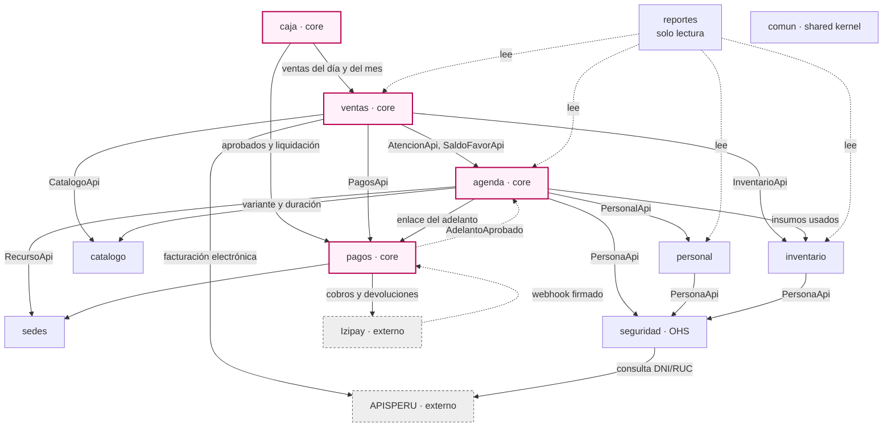

### 1.9 Trazabilidad CUS → módulo → agregado → tablas

Los 67 casos de uso quedan asignados a un módulo dueño y a los agregados que modifican. La columna «Tablas que escribe» es la de la hoja «Trazabilidad CUS» del diccionario v5 (27/10/2026), que incluye lo que Oracle escribe por trigger dentro de la misma operación; los RF son los de la matriz y la prioridad la de su hoja 4, heredada del CUS del que salió (columna «Venía de»). Esta tabla es la entrada de la Sección 2 (una realización por caso de uso).

| CUS | Caso de uso | Actor | Módulo dueño | Agregados que modifica | Tablas que escribe | RF | Prioridad | Venía de |
| --- | --- | --- | --- | --- | --- | --- | --- | --- |
| CUS01 | Buscar Clienta | Recepcionista | agenda | Ninguno (solo lectura) | Ninguna; lee PERSONA, CLIENTE | RF01 | 7,00 Primario | CUS01 |
| CUS02 | Registrar Clienta | Recepcionista | agenda | Persona, Cliente | PERSONA, CLIENTE | RF03, RF04, RF05, RF97, RF99 | 7,00 Primario | CUS01 |
| CUS03 | Consultar Ficha de Clienta | Recepcionista | agenda | Ninguno (solo lectura) | Ninguna; lee PERSONA, CLIENTE, CITA, ATENCION, VENTA, CLIENTE\_PAQUETE, V\_SALDO\_FAVOR\_CLIENTE, V\_SESIONES\_PAQUETE | RF02 | 7,00 Primario | CUS01 |
| CUS04 | Actualizar Clienta | Recepcionista | agenda | Cliente; Persona (vía API) | PERSONA, CLIENTE | RF02, RF05, RF97, RF99 | 7,00 Primario | CUS01 |
| CUS05 | Programar Cita | Recepcionista | agenda | Cita | CITA | RF06, RF07, RF08 | 9,10 Primario | CUS02 |
| CUS06 | Registrar Lista de Espera | Recepcionista | agenda | ListaEspera | LISTA\_ESPERA | RF09 | 9,10 Primario | CUS02 |
| CUS07 | Registrar Adelanto de Reserva | Recepcionista | agenda | Cita, TransaccionPasarela | CITA, TRANSACCION\_PASARELA | RF10, RF104 | 9,10 Primario | CUS02 |
| CUS08 | Consultar Agenda | Recepcionista | agenda | Ninguno (solo lectura) | Ninguna; lee CITA, ATENCION, RECURSO, PERSONAL, V\_AGENDA\_BLOQUES | RF11 | 9,10 Primario | CUS02 |
| CUS09 | Reprogramar Cita | Recepcionista | agenda | Cita | CITA | RF12 | 6,50 Primario | CUS03 |
| CUS10 | Cancelar Cita | Recepcionista | agenda | Cita, Cliente | CITA, SALDO\_FAVOR\_MOV | RF12 | 6,50 Primario | CUS03 |
| CUS11 | Registrar Atención | Especialista Técnica | agenda | Cita, Atencion, ClientePaquete | ATENCION, CITA | RF13, RF14, RF15 | 6,50 Primario | CUS04 |
| CUS12 | Registrar Recomendación de Producto | Especialista Técnica | agenda | Atencion | RECOMENDACION\_PRODUCTO | RF16 | 6,50 Primario | CUS04 |
| CUS13 | Registrar Atención sin Cita | Recepcionista | agenda | Atencion | ATENCION | RF17, RF18, RF19, RF20 | 7,90 Primario | CUS20 |
| CUS14 | Enviar Recordatorio de Cita | Recepcionista | agenda | Cita | CITA | RF89 | 4,40 Secundario | CUS18 |
| CUS15 | Consultar Clientas Inactivas | Administradora | agenda | Ninguno (solo lectura) | Ninguna; lee V\_CLIENTAS\_FUERA\_CICLO | RF90 | 4,40 Secundario | CUS18 |
| CUS16 | Registrar Membresía | Administradora | agenda | ClientePaquete | CLIENTE\_PAQUETE | RF91 | 4,40 Secundario | CUS18 |
| CUS17 | Reservar Cita en Línea | Clienta | agenda | — (sin tablas en v5) | Ninguna (fuera de alcance en v5) | RF94 | 6,00 Secundario | CUS19 |
| CUS18 | Cobrar Venta | Recepcionista | ventas | Venta; TransaccionPasarela, Cliente, ClientePaquete (vía API); Atencion, Producto (por Oracle) | VENTA, VENTA\_DETALLE, VENTA\_PAGO, TRANSACCION\_PASARELA, SALDO\_FAVOR\_MOV, CLIENTE\_PAQUETE, ATENCION, MOVIMIENTO\_KARDEX, INVENTARIO\_SEDE | RF21, RF22, RF23, RF24, RF25, RF26, RF30, RF103 | 9,50 Primario | CUS05 |
| CUS19 | Emitir Comprobante Electrónico | Recepcionista | ventas | Venta; SerieComprobante (por Oracle) | COMPROBANTE, SERIE\_COMPROBANTE | RF27, RF28, RF29, RF98, RF100, RF101 | 9,50 Primario | CUS05 |
| CUS20 | Entregar Comprobante | Recepcionista | ventas | Ninguno (solo lectura) | Ninguna; lee COMPROBANTE | RF102 | 9,50 Primario | CUS05 |
| CUS21 | Emitir Proforma | Recepcionista | ventas | Ninguno (solo lectura) | Ninguna; lee VARIANTE\_SERVICIO, PAQUETE, PROMOCION | RF31 | 9,50 Primario | CUS05 |
| CUS22 | Anular Venta | Recepcionista | ventas | Venta; Atencion, ClientePaquete, Cliente, Producto (por Oracle) | VENTA, ATENCION, CLIENTE\_PAQUETE, SALDO\_FAVOR\_MOV, MOVIMIENTO\_KARDEX, INVENTARIO\_SEDE | RF32, RF34, RF106 | 7,10 Primario | CUS07 |
| CUS23 | Emitir Nota de Crédito | Administradora | ventas | Venta; SerieComprobante (por Oracle) | COMPROBANTE, NOTA\_CREDITO, SERIE\_COMPROBANTE | RF33 | 7,10 Primario | CUS07 |
| CUS24 | Devolver Pago Digital | Administradora | pagos | TransaccionPasarela | TRANSACCION\_PASARELA | RF106 | 7,10 Primario | CUS07 |
| CUS25 | Buscar Producto | Recepcionista | ventas | Ninguno (solo lectura) | Ninguna; lee PRODUCTO, CATEGORIA\_PRODUCTO, INVENTARIO\_SEDE | RF35 | 7,20 Primario | CUS06 |
| CUS26 | Vender Producto | Recepcionista | ventas | Venta; TransaccionPasarela (vía API); Producto (por Oracle) | VENTA, VENTA\_DETALLE, VENTA\_PAGO, TRANSACCION\_PASARELA, MOVIMIENTO\_KARDEX, INVENTARIO\_SEDE | RF36, RF37, RF38, RF39, RF103 | 7,20 Primario | CUS06 |
| CUS27 | Registrar Pedido en Línea | Clienta | ventas | — (sin tablas en v5) | Ninguna (fuera de alcance en v5) | RF95 | 6,00 Secundario | CUS19 |
| CUS28 | Registrar Proveedor | Encargada de Almacén | inventario | Proveedor; Persona (vía API) | PERSONA, PROVEEDOR | RF40, RF98 | 5,70 Secundario | CUS10 |
| CUS29 | Registrar Requerimiento de Compra | Encargada de Almacén | inventario | RequerimientoCompra | REQUERIMIENTO\_COMPRA, REQUERIMIENTO\_DETALLE | RF41 | 5,70 Secundario | CUS10 |
| CUS30 | Evaluar Requerimiento de Compra | Administradora | inventario | RequerimientoCompra | REQUERIMIENTO\_COMPRA | RF42 | 5,70 Secundario | CUS10 |
| CUS31 | Registrar Compra | Encargada de Almacén | inventario | Compra, RequerimientoCompra; Producto (por Oracle) | COMPRA, COMPRA\_DETALLE, MOVIMIENTO\_KARDEX, INVENTARIO\_SEDE, REQUERIMIENTO\_COMPRA | RF43 | 5,70 Secundario | CUS10 |
| CUS32 | Registrar Producto | Encargada de Almacén | inventario | Producto | PRODUCTO, INVENTARIO\_SEDE | RF44, RF45, RF86, RF87 | 7,70 Primario | CUS09 |
| CUS33 | Registrar Salida de Insumos | Encargada de Almacén | inventario | Producto | MOVIMIENTO\_KARDEX, INVENTARIO\_SEDE | RF46, RF47 | 7,70 Primario | CUS09 |
| CUS34 | Registrar Ajuste de Inventario | Encargada de Almacén | inventario | Producto | MOVIMIENTO\_KARDEX, INVENTARIO\_SEDE | RF47, RF48 | 7,70 Primario | CUS09 |
| CUS35 | Consultar Kardex | Encargada de Almacén | inventario | Ninguno (solo lectura) | Ninguna; lee V\_KARDEX, MOVIMIENTO\_KARDEX | RF50 | 7,70 Primario | CUS09 |
| CUS36 | Registrar Personal | Administradora | personal | Personal; Persona (vía API) | PERSONA, PERSONAL, PERSONAL\_AREA, HORARIO\_PERSONAL | RF51, RF52, RF97 | 5,20 Secundario | CUS11 |
| CUS37 | Actualizar Personal | Administradora | personal | Personal; Persona (vía API) | PERSONA, PERSONAL, PERSONAL\_AREA, HORARIO\_PERSONAL | RF52 | 5,20 Secundario | CUS11 |
| CUS38 | Desactivar Personal | Administradora | personal | Personal; Usuario (por Oracle) | PERSONAL, USUARIO | RF53 | 5,20 Secundario | CUS11 |
| CUS39 | Registrar Asistencia | Recepcionista | personal | Asistencia | ASISTENCIA | RF54, RF55 | 5,70 Secundario | CUS12 |
| CUS40 | Corregir Asistencia | Administradora | personal | Asistencia; Auditoria (vía API) | ASISTENCIA, AUDITORIA | RF56 | 5,70 Secundario | CUS12 |
| CUS41 | Registrar Adelanto de Sueldo | Administradora | personal | Adelanto | ADELANTO | RF57 | 6,70 Primario | CUS13 |
| CUS42 | Calcular Planilla | Administradora | personal | Planilla | PLANILLA, PLANILLA\_DETALLE, ADELANTO | RF58, RF59, RF61 | 6,70 Primario | CUS13 |
| CUS43 | Generar Recibo de Pago | Administradora | personal | Ninguno (solo lectura) | Ninguna; lee PLANILLA, PLANILLA\_DETALLE, PERSONA | RF60 | 6,70 Primario | CUS13 |
| CUS44 | Abrir Caja | Recepcionista | caja | Caja | CAJA | RF62 | 7,50 Primario | CUS08 |
| CUS45 | Cerrar Caja | Recepcionista | caja | Caja | CAJA, CAJA\_ARQUEO, CAJA\_EGRESO | RF63, RF64, RF65, RF66 | 7,50 Primario | CUS08 |
| CUS46 | Aprobar Cierre de Caja | Administradora | caja | Caja | CAJA | RF67 | 7,50 Primario | CUS08 |
| CUS47 | Conciliar Ventas del Mes | Administradora | caja | Conciliacion; TransaccionPasarela (vía API) | CONCILIACION, CONCILIACION\_ITEM, TRANSACCION\_PASARELA | RF75, RF76, RF105 | 7,80 Primario | CUS17 |
| CUS48 | Generar Reporte Gerencial | Administradora | reportes | Ninguno (solo lectura) | Ninguna; lee V\_VENTA\_VALIDA, V\_VENTA\_LINEA, V\_VENTAS\_DIARIAS, V\_MARGEN\_PRODUCTO, V\_COSTO\_SERVICIO, V\_DEMANDA\_SERVICIOS, V\_OCUPACION\_RECURSO | RF68, RF69, RF70, RF71, RF72, RF73, RF93 | 7,00 Primario | CUS16 |
| CUS49 | Exportar Reporte | Administradora | reportes | Ninguno (solo lectura) | Ninguna; lee las vistas de reporte de CUS48 | RF74 | 7,00 Primario | CUS16 |
| CUS50 | Iniciar Sesión | Personal del Spa | seguridad | Usuario, Auditoria | USUARIO, AUDITORIA | RF77, RF78 | 7,10 Primario | CUS15 |
| CUS51 | Cerrar Sesión | Personal del Spa | seguridad | Auditoria | AUDITORIA | RF79 | 7,10 Primario | CUS15 |
| CUS52 | Registrar Usuario | Administradora | seguridad | Usuario | USUARIO | RF81 | 6,50 Primario | CUS21 |
| CUS53 | Asignar Rol | Administradora | seguridad | Usuario, Rol | USUARIO, ROL, PERMISO, ROL\_PERMISO | RF78, RF81 | 6,50 Primario | CUS21 |
| CUS54 | Restablecer Contraseña | Administradora | seguridad | Usuario | USUARIO | RF82 | 6,50 Primario | CUS21 |
| CUS55 | Consultar Auditoría | Administradora | seguridad | Ninguno (solo lectura) | Ninguna; lee V\_AUDITORIA | RF80 | 7,10 Primario | CUS15 |
| CUS56 | Registrar Incidente de Seguridad | Administradora | seguridad | IncidenteSeguridad | INCIDENTE\_SEGURIDAD | RF96 | 4,60 Secundario | CUS22 |
| CUS57 | Registrar Servicio | Administradora | catalogo | Area, Servicio | AREA, SERVICIO, VARIANTE\_SERVICIO, SERVICIO\_INSUMO | RF49, RF83 | 6,70 Primario | CUS14 |
| CUS58 | Actualizar Servicio | Administradora | catalogo | Servicio | SERVICIO, VARIANTE\_SERVICIO, SERVICIO\_INSUMO | RF83 | 6,70 Primario | CUS14 |
| CUS59 | Registrar Paquete | Administradora | catalogo | Paquete | PAQUETE, PAQUETE\_SERVICIO | RF84 | 6,70 Primario | CUS14 |
| CUS60 | Registrar Promoción | Administradora | catalogo | Promocion | PROMOCION, PROMOCION\_SERVICIO | RF84 | 6,70 Primario | CUS14 |
| CUS61 | Registrar Recurso | Administradora | sedes | Recurso | RECURSO | RF85 | 6,70 Primario | CUS14 |
| CUS62 | Configurar Medio de Pago | Administradora | pagos | MedioPago | MEDIO\_PAGO | RF88 | 6,70 Primario | CUS14 |
| CUS63 | Configurar Serie de Comprobante | Administradora | ventas | SerieComprobante | SERIE\_COMPROBANTE | RF107 | 6,70 Primario | CUS14 |
| CUS64 | Registrar Sede | Administradora | sedes | Sede | SEDE | RF92 | 6,00 Secundario | CUS19 |
| CUS65 | Configurar Parámetro del Negocio | Administradora | seguridad | Parametro | PARAMETRO, TIPO\_DOCUMENTO | RF87 | 6,70 Primario | CUS14 |
| CUS66 | Registrar Categoría de Producto | Encargada de Almacén | inventario | CategoriaProducto | CATEGORIA\_PRODUCTO | RF45 | 7,70 Primario | CUS09 |
| CUS67 | Publicar Canal en Línea | Administradora | sedes | — (sin tablas en v5) | Ninguna (fuera de alcance en v5) | RF94, RF95 | 6,00 Secundario | CUS19 |

Los 107 RF quedan cubiertos por al menos un caso de uso (comprobado con el generador de los diagramas). RF94 y RF95 son Won't Have y el v5 retiró sus tablas: CUS17, CUS27 y CUS67 quedan sin realización y sin rutas en la API. RF97 y RF98 se citan en todos los CUS que consultan un documento (CUS02, CUS04, CUS19, CUS28 y CUS36). El generador compara lo que escribe cada diagrama de secuencia con esta hoja: coinciden en los 64 CUS con realización (las 3 diferencias del 27/10/2026, O-15 a O-17, las corrigió el diccionario el 01/11/2026). La prioridad se heredó del CUS de origen y la dueña la validó el 24/10/2026 (matriz, hoja 4).

### 1.10 Observaciones de consistencia para el equipo

Al cruzar caso, matriz, diccionario y Unidad 1 salieron 20 observaciones. Las 14 primeras están cerradas o actualizadas con el v5; de las 6 nuevas del 27/10/2026, O-18 y O-19 se resolvieron en los diagramas, O-15 a O-17 las corrigió el equipo de BD el 01/11/2026 y O-20 es opcional. Ninguna bloquea el catálogo UML.

| Código | Dónde | Diferencia encontrada | Propuesta | Estado |
| --- | --- | --- | --- | --- |
| O-01 | Matriz, hojas 2, 4 y 6 | Tres casos de uso tenían dos nombres (por ejemplo, «Registro de Clientas» / «Buscar, Registrar y Editar Clientas») | Con los 67 CUS del 23/10/2026 cada caso de uso tiene un solo nombre en las hojas 2, 4 y 6, en el diccionario y en los documentos | Resuelta 23/10/2026 |
| O-02 | Diccionario, hoja Leyenda | Decía que la trazabilidad cubría 21 casos de uso | La leyenda dice ahora 67 casos de uso | Resuelta 23/10/2026 |
| O-03 | RN17 frente a CUS11 (antes CUS04) y RF46 | RN17: solo almacén y administradora registran movimientos; la trazabilidad asignaba MOVIMIENTO\_KARDEX a la atención | RN17 rige el abastecimiento; la salida por venta la genera el sistema al cerrar la venta (RF38, RF39) y la salida de insumos la registran la encargada o la administradora (RF46, CUS33) | Resuelta 20/10/2026 |
| O-04 | Diccionario, COMPRA | COMPRA conserva id\_solicitud (v2) e id\_requerimiento (v3); desde v3 la compra se liga al requerimiento | id\_solicitud quedó obsoleta el 24/10/2026 y el diccionario v5 la retiró del esquema, junto con COMPRA\_DETALLE.cantidad\_aprobada. El agregado Compra se liga solo por id\_requerimiento | Cerrada en v5 (27/10/2026) |
| O-05 | CUS14 anterior | Un solo caso de uso escribía en 6 módulos | Al separar los CUS, cada parámetro tiene su CUS en su módulo dueño: CUS57–CUS60 (catalogo), CUS61 (sedes), CUS62 (pagos), CUS63 (ventas) y CUS32 (inventario) | Resuelta 23/10/2026 |
| O-06 | RN05 frente a CK\_SALDO\_FAVOR\_MOV\_ORIGEN | El CHECK admite un ABONO originado en una venta anulada | La regla RN44 (v4) lo cubre: se devuelve por el mismo medio y solo va a saldo a favor si la clienta lo elige (CUS24) | Reemplazada por RN44 |
| O-07 | Diccionario, CUS18 anterior | La trazabilidad decía que CUS18 escribía PAQUETE, pero crear paquetes es RF84 | La hoja «Trazabilidad CUS» del 23/10/2026 deja PAQUETE solo en CUS59; CUS16 escribe CLIENTE\_PAQUETE y CUS11 CONSUMO\_SESION | Resuelta 23/10/2026 |
| O-08 | Matriz, hoja 0 | El rol de la contadora externa estaba copiado del proveedor | La hoja 0 del v4 ya dice «Recibe los reportes y declara los impuestos…» | Resuelta en v4 |
| O-09 | Diccionario, hoja Trazabilidad CUS | El CUS14 anterior no listaba MEDIO\_PAGO aunque RF88 configura los medios de pago | CUS62 Configurar Medio de Pago escribe MEDIO\_PAGO | Resuelta 23/10/2026 |
| O-10 | Matriz, hoja 2 | RF97 (DNI) y RF98 (RUC) solo estaban en CUS01 y CUS05 aunque su texto cubre al personal y al proveedor | RF97 está ahora en CUS02, CUS04 y CUS36, y RF98 en CUS19 y CUS28 | Resuelta 23/10/2026 |
| O-11 | Unidad 1, doc 04 (C3.0) | La lista de SPI de `comun` no incluye `ComisionesDelMes` ni `PorcentajeComisionProvider`, que usan CUS42 y la línea de venta (RN38) para no crear el ciclo personal ⇄ ventas | Agregarlos a la lista de SPI del doc 04 | Resuelta 23/10/2026 (doc 04, reglas de dependencia y C3.0) |
| O-12 | Diccionario, tablas de referencia | Al separar los CUS, siete tablas quedaron sin un CUS que las escriba: LINEA, AREA, CATEGORIA\_PRODUCTO, ROL, PERMISO, ROL\_PERMISO y PARAMETRO (los CUS solo las leen) | CUS65 escribe PARAMETRO (RF87) y, desde el v5, también TIPO\_DOCUMENTO; CUS66 escribe CATEGORIA\_PRODUCTO (RF45). El v5 retiró LINEA (la línea es AREA.linea) y asigna AREA a CUS57 y ROL, PERMISO y ROL\_PERMISO a CUS53; los valores iniciales los sigue cargando el script | Actualizada 27/10/2026 (v5) |
| O-13 | Matriz, RF94 y RF95 | SEDE\_CANAL (canal en línea de cada sede) quedó sin un CUS que la escriba al separar los CUS; CUS17 y CUS27 solo la leen | El diccionario v5 retiró SEDE\_CANAL, PEDIDO y PEDIDO\_DETALLE porque RF94 y RF95 son Won't Have: CUS17, CUS27 y CUS67 quedan sin tablas ni realización hasta que entren al alcance | Cerrada en v5 (27/10/2026) |
| O-14 | Unidad 1, doc 04 | CUS38 usa el evento nuevo `PersonalDesactivado` (personal → seguridad) para bloquear el usuario sin crear el ciclo personal ⇄ seguridad | Reemplazada por O-18: con el v5 la baja del usuario la hace Oracle (TRG\_PERSONAL\_DESACTIVAR) y ya no se usa el evento | Reemplazada por O-18 |
| O-15 | Diccionario v5, hoja Trazabilidad CUS (CUS26) | CUS26 Vender Producto no listaba TRANSACCION\_PASARELA, pero un producto pagado con Yape, Plin o tarjeta se cobra por la pasarela y solo cuenta con la transacción APROBADA (RN42, RF103) | El diccionario agregó TRANSACCION\_PASARELA a CUS26 (cambio 214) y la matriz agregó RF103 a CUS26; el diagrama de CUS26 cita RF103 en PagosApi.cobrar | Resuelta 01/11/2026 |
| O-16 | Diccionario v5, hoja Trazabilidad CUS (CUS31) | CUS31 Registrar Compra solo consultaba REQUERIMIENTO\_COMPRA, pero la compra deja el requerimiento ATENDIDO y ningún trigger del script v5 lo hace | REQUERIMIENTO\_COMPRA pasó a escritura de CUS31 (cambio 215): la aplicación lo marca ATENDIDO al recibir todo lo pedido, como hace el diagrama con RequerimientoCompra.marcarAtendido() | Resuelta 01/11/2026 |
| O-17 | Diccionario v5, hoja Trazabilidad CUS (CUS24) | CUS24 Devolver Pago Digital listaba SALDO\_FAVOR\_MOV, pero el abono por SALDO\_FAVOR lo hace Oracle al anular la venta (PKG\_VENTA.al\_anular, CUS22) y saldría doble | Se quitó SALDO\_FAVOR\_MOV de CUS24 (cambio 216) y la BD lo bloquea: TRG\_SALDO\_FAVOR\_REGLAS rechaza con -20063 un ABONO sin cita fuera de la anulación (cambio 217, probado en 20\_pruebas\_reglas\_v5.sql). La matriz agregó RF106 a CUS22, donde se elige la forma de devolución | Resuelta 01/11/2026 |
| O-18 | Unidad 2 (CUS38) frente al script v5 | El diseño usaba el evento PersonalDesactivado para que seguridad bloquee el usuario, pero TRG\_PERSONAL\_DESACTIVAR ya deja el USUARIO INACTIVO en la misma transacción (RF53), como dice la hoja Trazabilidad CUS | Se sigue a la BD: CUS38 solo actualiza PERSONAL y se retiran el evento y ManejadorPersonalDesactivado; tampoco hay ciclo personal ⇄ seguridad | Resuelta 27/10/2026 |
| O-19 | Unidad 2 (CUS18, CUS22, CUS26 y CUS31) frente al script v5 | Los diagramas del v4 llamaban desde Java a marcarCobrada, registrarSalida y registrarEntrada, que Oracle ya hace con TRG\_VENTA\_EFECTOS (PKG\_VENTA.al\_cerrar y al\_anular) y TRG\_COMPRA\_DETALLE\_KARDEX: el efecto saldría doble | Los diagramas v5 muestran esos efectos en el mensaje a la BD y el backend ya no los repite | Resuelta 27/10/2026 |
| O-20 | Unidad 1, doc 04 (C3 de seguridad) | El C3 nombra ConsultaDocumentoService y ConsultaDocumentoApi; con el v5 ese mismo componente de seguridad también guarda PERSONA y en la Unidad 2 se llama ServicioPersona (PersonaApi). No cambia módulos, contenedores ni estilo | Opcional: renombrar el componente en el C3 cuando se toque el doc 04; mientras tanto la tabla 2.2 da la equivalencia | Abierta (opcional, no bloquea) |

## Sección 2 · Modelo de análisis RUP (BCE) y realizaciones de casos de uso

64 de los 67 casos de uso tienen su realización «trace» con diagrama de secuencia, diagrama de clases del análisis y diagrama de clases del diseño en el draw.io «Diagramas de secuencia y clase» (71 páginas); CUS17, CUS27 y CUS67 conservan su página, pero sin realización, porque el diccionario v5 retiró sus tablas. El generador del archivo comprobó que los 1656 mensajes respetan las secuencias BCE permitidas, que cada mensaje es un método de la clase que lo recibe, que cada RF citado en un flujo pertenece a ese CUS en la matriz y que toda tabla nombrada existe en el diccionario v5.

### 2.1 Estereotipos, nombres y reglas

| Estereotipo | Convención de nombre | Clases en el modelo | Regla |
| --- | --- | --- | --- |
| Actor (persona) | Rol del caso | 5: Recepcionista, Especialista Técnica, Encargada de Almacén, Administradora y Personal del Spa (la Clienta solo aparece en CUS17 y CUS27, sin realización en v5) | Clase solo con atributos, sin métodos (como el «Cajero» del ejemplo del profesor) |
| Actor (sistema externo) | Nombre del sistema | 1: Izipay | Solo envía la notificación del pago (webhook) |
| Frontera | `IGU_<pantalla>` para personas; `IS_<interfaz>` para sistemas | 28: 27 IGU y `IS_NotificacionPasarela` | Toda interacción de un actor entra por una frontera; la IGU valida con `validar()` |
| Control de entrada | `Controlador<Recurso>` | 29 | Recibe la petición HTTP; cada método lleva su verbo y su ruta |
| Control de caso de uso | `Servicio<Recurso>` | 29 (incluye `ServicioPersona`, que implementa `PersonaApi`) | Orquesta el caso de uso y la transacción |
| Control de dominio | `Gestor`, `Manejador`, `Calculadora`, `Codificador`, `Generador` | 5 | Regla que cruza agregados (`GestorDisponibilidadAgenda`), evento (`ManejadorAdelantoConfirmado`) o cálculo puro |
| Contrato de otro módulo | `<Nombre>Api`, `<Nombre>Provider`, `<Nombre>Port` | 15 (nuevos en v5: `PersonaApi` y `AuditoriaApi`) | Un módulo solo llama a otro por su API publicada o por un SPI de `comun` |
| Adaptador | `Adaptador<Proveedor>` | 3 | Traduce el dominio al formato de APISPERU o Izipay (capa anticorrupción) |
| API externa | `API <proveedor>` (control en rojo) | 3: API APISPERU Facturación, API APISPERU Consulta, API Izipay | Se dibuja como el «API SUNAT» del ejemplo del profesor: un control que solo llama el adaptador |
| Repositorio | `Repositorio<Entidad>` | 37 | Único que habla con Oracle |
| Entidad | Tabla del diccionario v5 en PascalCase | 35 en las secuencias; 55 en el modelo de dominio | Atributos = columnas exactas; métodos = comandos de la raíz (1.6); los subtipos se dibujan con generalización a su supertipo |

**Secuencias.** Permitidas: Actor → Frontera → Control → Entidad; Control → Control; Frontera → Control → Frontera. Prohibidas y comprobadas en las 64 realizaciones: Actor → Control, Actor → Entidad e IGU → Entidad (0 casos). Los servicios y repositorios los inyecta Spring, por eso no aparece un `new()` para ellos; las entidades sí se crean con `oX = new X(...)`. Lo que Oracle hace por trigger se escribe entre paréntesis en el mensaje a la BD, por ejemplo `UPDATE VENTA (TRG_VENTA_EFECTOS: …)`.

### 2.2 De la clase de análisis al componente de la Unidad 1

El análisis usa la nomenclatura de la cátedra; el código usa la de los diagramas C3 y C4 del doc 04. La correspondencia es uno a uno, salvo `ServicioSerieComprobante`, que separa en una capa de servicio lo que C3.1 dibuja como acceso directo del controlador.

| Clase de análisis y diseño (este documento) | Componente de la Unidad 1 (doc 04) | Módulo |
| --- | --- | --- |
| `ControladorX`, `ServicioX`, `RepositorioX` | `XController`, `XService`, `XRepository` (por ejemplo `ControladorVenta` = `VentaController`) | Todos |
| `GestorDisponibilidadAgenda` | `DisponibilidadService` (servicio de dominio) | agenda |
| `ManejadorAdelantoConfirmado` | `AdelantoConfirmadoListener` | agenda |
| `ControladorClientePaquete`, `ServicioClientePaquete` (implementa `PaqueteClienteApi`) | `ClientePaqueteController`, `ClientePaqueteService` + `PaqueteClienteApi` | agenda |
| `ServicioPago` (implementa `PagosApi`) | `PagoService` + `PagosApi` | pagos |
| `ControladorNotificacionPasarela` + `IS_NotificacionPasarela` | `NotificacionPasarelaController` (webhook) | pagos |
| `AdaptadorIzipay` | `IzipayAdapter` (implementa `PasarelaPagosPort`) | pagos |
| `ServicioFacturacionElectronica` | `FacturacionElectronicaService` | ventas |
| `AdaptadorApisPeruFacturacion` | `ApisPeruFacturacionAdapter` (implementa `FacturacionElectronicaPort`) | ventas |
| `ControladorAnulacion`, `ServicioAnulacion` | `AnulacionController`, `AnulacionService` | ventas |
| `ControladorComprobante` | `ComprobanteController` | ventas |
| `ControladorSerieComprobante` + `ServicioSerieComprobante` | `SerieComprobanteController` | ventas |
| `ServicioVentaRapida` | `VentaRapidaService` (delega el cobro en `VentaService`) | ventas |
| `VentasConsultaApi` | `VentasConsultaApi` | ventas |
| `ControladorAdelanto`, `ServicioAdelanto` | `AdelantoController`, `AdelantoService` (adelanto de sueldo, CUS41) | personal |
| `ControladorRecurso`, `ServicioRecurso` | `RecursoController`, `RecursoService` (CUS61) | sedes |
| `ServicioPersona` (implementa `PersonaApi`) | `ConsultaDocumentoService` + `ConsultaDocumentoApi` del C3; en v5 también guarda PERSONA (O-20) | seguridad |
| `AdaptadorApisPeruConsulta` | `ApisPeruConsultaAdapter` (implementa `ConsultaDocumentoPort`) | seguridad |
| `ControladorAuditoria`, `ServicioAuditoria` | `AuditoriaController`, `AuditoriaService` (CUS55) | seguridad |
| `AuditoriaApi` (la implementa `ServicioAuditoria`) | SPI solo para lo que Oracle no ve: inicio de sesión fallido, cierre de sesión y acceso denegado; el resto, incluida la corrección de asistencia de CUS40, lo registran los triggers `TRG_AUD_*` (It. 2) | seguridad |
| `AlmacenArchivosPort`, `CajaAbiertaProvider`, `UsuarioActual`, `ParametroApi`, `HistorialComprasProvider` | Mismos nombres, más HistorialComprasProvider desde la It. 2 (SPI de `comun`) | comun |
| `ControladorParametro`, `ServicioParametro` (implementa `ParametroApi`) | `ParametroController`, `ParametroService` + `ParametroApi` (CUS65, también tipos de documento) | seguridad |

### 2.3 Realizaciones por caso de uso

Cada fila es una página del draw.io («CUSnn …»): caso de uso con su realización «trace», secuencia, clases del análisis y clases del diseño.

| CUS | Actor | Fronteras | Controles (sin repositorios) | Entidades | API externas |
| --- | --- | --- | --- | --- | --- |
| CUS01 Buscar Clienta | Recepcionista | IGU\_Clientas | ControladorCliente, ServicioCliente, PersonaApi | — | — |
| CUS02 Registrar Clienta | Recepcionista | IGU\_Clientas | ControladorCliente, ServicioCliente, ServicioPersona, AdaptadorApisPeruConsulta | TipoDocumento, Persona, Cliente | API APISPERU Consulta |
| CUS03 Consultar Ficha de Clienta | Recepcionista | IGU\_Clientas | ControladorCliente, ServicioCliente, PersonaApi, HistorialComprasProvider | — | — |
| CUS04 Actualizar Clienta | Recepcionista | IGU\_Clientas | ControladorCliente, ServicioCliente, PersonaApi | Cliente | — |
| CUS05 Programar Cita | Recepcionista | IGU\_Agenda | ControladorCita, ServicioCita, GestorDisponibilidadAgenda | Cita | — |
| CUS06 Registrar Lista de Espera | Recepcionista | IGU\_Agenda | ControladorCita, ServicioCita, GestorDisponibilidadAgenda | ListaEspera | — |
| CUS07 Registrar Adelanto de Reserva | Recepcionista, Izipay | IGU\_Agenda, IS\_NotificacionPasarela | ControladorCita, ServicioCita, CajaAbiertaProvider, ManejadorAdelantoConfirmado, ControladorNotificacionPasarela, ServicioPago, AdaptadorIzipay | Cita, TransaccionPasarela | API Izipay |
| CUS08 Consultar Agenda | Recepcionista | IGU\_Agenda | ControladorCita, ServicioCita, GestorDisponibilidadAgenda | — | — |
| CUS09 Reprogramar Cita | Recepcionista | IGU\_Agenda | ControladorCita, ServicioCita, GestorDisponibilidadAgenda | Cita | — |
| CUS10 Cancelar Cita | Recepcionista | IGU\_Agenda | ControladorCita, ServicioCita | Cita, Cliente | — |
| CUS11 Registrar Atención | Especialista Técnica | IGU\_Atencion | ControladorAtencion, ServicioAtencion, GestorDisponibilidadAgenda | Cita, Atencion, ClientePaquete | — |
| CUS12 Registrar Recomendación de Producto | Especialista Técnica | IGU\_Atencion | ControladorAtencion, ServicioAtencion, InventarioApi | Atencion | — |
| CUS13 Registrar Atención sin Cita | Recepcionista | IGU\_VentaRapida | ControladorVentaRapida, ServicioVentaRapida, AtencionApi, GestorDisponibilidadAgenda, ServicioVenta | Atencion | — |
| CUS14 Enviar Recordatorio de Cita | Recepcionista | IGU\_Recordatorios | ControladorRecordatorio, ServicioRecordatorio, PersonaApi, PuertoNotificacion | Cita | — |
| CUS15 Consultar Clientas Inactivas | Administradora | IGU\_Clientas | ControladorCliente, ServicioCliente | — | — |
| CUS16 Registrar Membresía | Administradora | IGU\_Membresias | ControladorClientePaquete, ServicioClientePaquete, CatalogoApi | ClientePaquete | — |
| CUS17 Reservar Cita en Línea (Won't Have) | Clienta | Sin realización: el diccionario v5 retiró sus tablas | — | — | — |
| CUS18 Cobrar Venta | Recepcionista | IGU\_Cobro | ControladorVenta, ServicioVenta, CajaAbiertaProvider, AtencionApi, SaldoFavorApi, CalculadoraVenta, PagosApi, PaqueteClienteApi, ServicioFacturacionElectronica | Venta | — |
| CUS19 Emitir Comprobante Electrónico | Recepcionista | IGU\_Cobro | ControladorVenta, ServicioVenta, PersonaApi, ServicioFacturacionElectronica, AlmacenArchivosPort, AdaptadorApisPeruFacturacion | Venta, Comprobante | API APISPERU Facturación |
| CUS20 Entregar Comprobante | Recepcionista | IGU\_Cobro | ControladorComprobante, ServicioFacturacionElectronica, AlmacenArchivosPort | — | — |
| CUS21 Emitir Proforma | Recepcionista | IGU\_Cobro | ControladorVenta, ServicioVenta, CatalogoApi, CalculadoraVenta | — | — |
| CUS22 Anular Venta | Recepcionista | IGU\_Anulacion | ControladorAnulacion, ServicioAnulacion, UsuarioActual, ServicioFacturacionElectronica | Venta | — |
| CUS23 Emitir Nota de Crédito | Administradora | IGU\_Anulacion | ControladorAnulacion, ServicioAnulacion, ServicioFacturacionElectronica, AlmacenArchivosPort, AdaptadorApisPeruFacturacion | NotaCredito | API APISPERU Facturación |
| CUS24 Devolver Pago Digital | Administradora | IGU\_Anulacion | ControladorAnulacion, ServicioAnulacion, ServicioPago, AdaptadorIzipay | TransaccionPasarela | API Izipay |
| CUS25 Buscar Producto | Recepcionista | IGU\_VentaProductos | ControladorVenta, ServicioVenta, InventarioApi | — | — |
| CUS26 Vender Producto | Recepcionista | IGU\_VentaProductos | ControladorVenta, ServicioVenta, CajaAbiertaProvider, InventarioApi, PagosApi, ServicioFacturacionElectronica | Venta | — |
| CUS27 Registrar Pedido en Línea (Won't Have) | Clienta | Sin realización: el diccionario v5 retiró sus tablas | — | — | — |
| CUS28 Registrar Proveedor | Encargada de Almacén | IGU\_Compras | ControladorCompra, ServicioCompra, PersonaApi | Proveedor | — |
| CUS29 Registrar Requerimiento de Compra | Encargada de Almacén | IGU\_Compras | ControladorCompra, ServicioCompra, ServicioProducto | RequerimientoCompra | — |
| CUS30 Evaluar Requerimiento de Compra | Administradora | IGU\_Compras | ControladorCompra, ServicioCompra | RequerimientoCompra | — |
| CUS31 Registrar Compra | Encargada de Almacén | IGU\_Compras | ControladorCompra, ServicioCompra | RequerimientoCompra, Compra | — |
| CUS32 Registrar Producto | Encargada de Almacén | IGU\_Inventario | ControladorProducto, ServicioProducto, ParametroApi | Producto | — |
| CUS33 Registrar Salida de Insumos | Encargada de Almacén | IGU\_Inventario | ControladorProducto, ServicioProducto | Producto | — |
| CUS34 Registrar Ajuste de Inventario | Encargada de Almacén | IGU\_Inventario | ControladorProducto, ServicioProducto | Producto | — |
| CUS35 Consultar Kardex | Encargada de Almacén | IGU\_Inventario | ControladorProducto, ServicioProducto | — | — |
| CUS36 Registrar Personal | Administradora | IGU\_Personal | ControladorPersonal, ServicioPersonal, PersonaApi | Personal | — |
| CUS37 Actualizar Personal | Administradora | IGU\_Personal | ControladorPersonal, ServicioPersonal, PersonaApi | Personal | — |
| CUS38 Desactivar Personal | Administradora | IGU\_Personal | ControladorPersonal, ServicioPersonal | Personal | — |
| CUS39 Registrar Asistencia | Recepcionista | IGU\_Asistencia | ControladorAsistencia, ServicioAsistencia | Asistencia | — |
| CUS40 Corregir Asistencia | Administradora | IGU\_Asistencia | ControladorAsistencia, ServicioAsistencia, AuditoriaApi | Asistencia | — |
| CUS41 Registrar Adelanto de Sueldo | Administradora | IGU\_Planilla | ControladorAdelanto, ServicioAdelanto | Adelanto | — |
| CUS42 Calcular Planilla | Administradora | IGU\_Planilla | ControladorPlanilla, ServicioPlanilla, ComisionesDelMes | Planilla | — |
| CUS43 Generar Recibo de Pago | Administradora | IGU\_Planilla | ControladorPlanilla, ServicioPlanilla, GeneradorExportacion, PersonaApi | Planilla | — |
| CUS44 Abrir Caja | Recepcionista | IGU\_Caja | ControladorCaja, ServicioCaja | Caja | — |
| CUS45 Cerrar Caja | Recepcionista | IGU\_Caja | ControladorCaja, ServicioCaja, VentasConsultaApi, PagosApi | Caja | — |
| CUS46 Aprobar Cierre de Caja | Administradora | IGU\_Caja | ControladorCaja, ServicioCaja | Caja | — |
| CUS47 Conciliar Ventas del Mes | Administradora | IGU\_Conciliacion | ControladorConciliacion, ServicioConciliacion, VentasConsultaApi, PagosApi | Conciliacion | — |
| CUS48 Generar Reporte Gerencial | Administradora | IGU\_Reportes | ControladorReporte, ServicioReporte | — | — |
| CUS49 Exportar Reporte | Administradora | IGU\_Reportes | ControladorReporte, ServicioReporte, GeneradorExportacion | — | — |
| CUS50 Iniciar Sesión | Personal del Spa | IGU\_Login | ControladorAutenticacion, ServicioAutenticacion | Usuario, Auditoria | — |
| CUS51 Cerrar Sesión | Personal del Spa | IGU\_Login | ControladorAutenticacion, ServicioAutenticacion | Auditoria | — |
| CUS52 Registrar Usuario | Administradora | IGU\_Usuarios | ControladorUsuario, ServicioUsuario, CodificadorClave | Usuario | — |
| CUS53 Asignar Rol | Administradora | IGU\_Usuarios | ControladorUsuario, ServicioUsuario | Usuario, Rol | — |
| CUS54 Restablecer Contraseña | Administradora | IGU\_Usuarios | ControladorUsuario, ServicioUsuario, CodificadorClave | Usuario | — |
| CUS55 Consultar Auditoría | Administradora | IGU\_Auditoria | ControladorAuditoria, ServicioAuditoria | — | — |
| CUS56 Registrar Incidente de Seguridad | Administradora | IGU\_Incidentes | ControladorIncidente, ServicioIncidente | IncidenteSeguridad | — |
| CUS57 Registrar Servicio | Administradora | IGU\_Catalogo | ControladorCatalogo, ServicioCatalogo | Area, Servicio | — |
| CUS58 Actualizar Servicio | Administradora | IGU\_Catalogo | ControladorCatalogo, ServicioCatalogo | Servicio | — |
| CUS59 Registrar Paquete | Administradora | IGU\_Catalogo | ControladorCatalogo, ServicioCatalogo | Paquete | — |
| CUS60 Registrar Promoción | Administradora | IGU\_Catalogo | ControladorCatalogo, ServicioCatalogo | Promocion | — |
| CUS61 Registrar Recurso | Administradora | IGU\_Recursos | ControladorRecurso, ServicioRecurso | Recurso | — |
| CUS62 Configurar Medio de Pago | Administradora | IGU\_MediosPago | ControladorMedioPago, ServicioPago | MedioPago | — |
| CUS63 Configurar Serie de Comprobante | Administradora | IGU\_SeriesComprobante | ControladorSerieComprobante, ServicioSerieComprobante | SerieComprobante | — |
| CUS64 Registrar Sede | Administradora | IGU\_Sedes | ControladorSede, ServicioSede | Sede | — |
| CUS65 Configurar Parámetro del Negocio | Administradora | IGU\_Parametros | ControladorParametro, ServicioParametro, UsuarioActual | Parametro, TipoDocumento | — |
| CUS66 Registrar Categoría de Producto | Encargada de Almacén | IGU\_Inventario | ControladorProducto, ServicioProducto | CategoriaProducto | — |
| CUS67 Publicar Canal en Línea (Won't Have) | Administradora | Sin realización: el diccionario v5 retiró sus tablas | — | — | — |

**Relaciones entre casos de uso.** Al separar los CUS, cada uno nombra una sola acción sobre un solo objeto del dominio, y lo que antes estaba dentro de un caso grande se une con «include» o «extend». **«include»:** CUS01 Buscar Clienta está incluido en CUS03, CUS04, CUS05 y CUS18; CUS19 Emitir Comprobante Electrónico, en CUS13, CUS18 y CUS26 (es la misma operación de cierre); CUS23 Emitir Nota de Crédito, en CUS22 (con el v5 la nota se emite primero y luego la venta pasa a ANULADA); CUS25 Buscar Producto, en CUS26. **«extend»:** CUS02 Registrar Clienta extiende CUS01 (la clienta no existe); CUS06 Registrar Lista de Espera extiende CUS05 (no hay horario libre); CUS24 Devolver Pago Digital extiende CUS22 (el pago anulado fue por la pasarela). El antiguo CUS14, que era un caso generalizado de parámetros, ahora son siete CUS (CUS57 a CUS63), cada uno escrito por su módulo dueño (O-05); después se agregaron CUS65, CUS66 y CUS67 (O-12, O-13). CUS17, CUS27 y CUS67 quedan sin realización en v5.

### 2.4 Diagramas generales

| Página del draw.io | Qué muestra |
| --- | --- |
| General · Clases del análisis | Las clases BCE de las 64 realizaciones agrupadas en los 10 módulos; dentro de cada módulo, la API de otro módulo aparece como «API de …» y los actores se repiten donde intervienen |
| General · Clases del diseño (dominio) | Las 55 entidades del diccionario v5 con todas sus columnas, agrupadas por módulo, con composiciones, asociaciones del mismo módulo y las dos herencias (PERSONA → CLIENTE, PERSONAL, PROVEEDOR; COMPROBANTE → NOTA\_CREDITO) |
| General · Clases del diseño (capas) | Controladores, servicios, contratos y repositorios por módulo, con la unión de los métodos de todas las secuencias |

## Sección 3 · Diseño de clases del dominio y transformación objeto-relacional

Las 55 tablas del diccionario v5 se convierten en 55 clases `@Entity` con sus 423 columnas como atributos, sin agregar ni quitar ninguna. De las 121 FK, 53 unen tablas del mismo módulo y se mapean como asociaciones JPA (una de ellas es la herencia COMPROBANTE → NOTA\_CREDITO); las 68 que cruzan módulos se guardan como un `Long` con el ID, incluidas las 3 de la herencia PERSONA (la FK sigue en Oracle). El diagrama completo está en la página «General · Clases del diseño (dominio)» del draw.io.

### 3.1 Reglas de transformación objeto-relacional

| En Oracle (diccionario v5) | En Java (JPA) | Cuántos | Ejemplo |
| --- | --- | --- | --- |
| PK simple `NUMBER GENERATED BY DEFAULT AS IDENTITY` | `Long` + `@Id @GeneratedValue(strategy = IDENTITY)`; el backend nunca la envía | 44 tablas | `VENTA.id_venta` → `Long idVenta` |
| PK compuesta de dos FK | `@EmbeddedId` con una clase `XId` `@Embeddable` y `@MapsId` en cada FK | 7 tablas | `REQUERIMIENTO_DETALLE (id_requerimiento, id_producto)` → `RequerimientoDetalleId` |
| PK de un subtipo (`NUMBER`, PK y FK a su supertipo) | Sin `@GeneratedValue`: el id lo da el supertipo. NOTA\_CREDITO: `@Inheritance(JOINED)` + `@PrimaryKeyJoinColumn`. CLIENTE, PERSONAL y PROVEEDOR: `@Id Long` asignado con el id que devuelve `PersonaApi` (jerarquía solapada y en otro módulo) | 4 tablas | `CLIENTE.id_cliente` = `PERSONA.id_persona` |
| FK a una tabla del mismo módulo | `@ManyToOne(fetch = LAZY)`; dentro del agregado, `@OneToMany(mappedBy, cascade = ALL, orphanRemoval = true)` desde la raíz | 53 FK (52 asociaciones y la herencia de NOTA\_CREDITO) | `VENTA_DETALLE.id_venta` → `Venta venta` |
| FK a una tabla de otro módulo | `Long` con el ID (referencia por identidad, DDD) | 68 FK (incluye PERSONA → CLIENTE, PERSONAL y PROVEEDOR) | `VENTA_PAGO.id_transaccion` → `Long idTransaccion` |
| `NUMBER(10,2)` | `BigDecimal` envuelto en `Dinero` en el dominio | Montos | `TRANSACCION_PASARELA.comision` |
| `NUMBER(5,2)` | `BigDecimal` (`Porcentaje` u horas) | Porcentajes y horas | `PERSONAL.porcentaje_comision` |
| `NUMBER(5)`, `NUMBER(10)` | `Integer` | Cantidades y minutos | `COMPROBANTE.intentos_envio` |
| `CHAR(1)` S/N | `Boolean` con `SiNoConverter` | 8 columnas | `MEDIO_PAGO.usa_pasarela` |
| `VARCHAR2` con CHECK IN (…) | `enum` con `@Enumerated(EnumType.STRING)` y los mismos literales | 47 enums; 2 compartidos entre tablas: `TipoRecurso` (RECURSO.tipo y SERVICIO.tipo\_recurso) y `TipoComprobante` (COMPROBANTE y SERIE\_COMPROBANTE) | `AREA.linea` → `LineaNegocio linea` |
| `DATE` / `TIMESTAMP` | `LocalDate` / `LocalDateTime` | — | `TRANSACCION_PASARELA.fecha_abono` → `LocalDate` |
| Columna que asigna o calcula Oracle | `@Column(insertable = false, updatable = false)` y relectura tras el `save` | COMPROBANTE (serie, numero, fecha\_emision, también de las notas de crédito); CAJA\_ARQUEO.monto\_esperado; VENTA\_PAGO.referencia; INVENTARIO\_SEDE.stock\_actual (solo por kardex) | `Comprobante.serie` |
| CONSTRAINT con nombre propio | El `ApiExceptionHandler` de `comun` traduce el nombre a un `ProblemDetail` legible (Sección 5.2) | Todas | `UQ_PERSONA_TELEFONO` → 409 «el teléfono ya pertenece a otra ficha» |
| Esquema | Lo crea el script del equipo; Hibernate solo lo valida (`ddl-auto = validate`) | 55 tablas | — |

**Herencia.** El diccionario v5 tiene dos jerarquías EER con PK compartida (hoja «Jerarquías»). COMPROBANTE → NOTA\_CREDITO es total y disjunta, y las dos tablas son de `ventas`: se mapea con `@Inheritance(strategy = JOINED)` en `Comprobante` y `NotaCredito extends Comprobante` con `@PrimaryKeyJoinColumn(name = "id_nota_credito")`; BOLETA y FACTURA no tienen tabla propia y son valores de `Comprobante.tipo`. PERSONA → CLIENTE, PERSONAL y PROVEEDOR es total y **solapada** (una persona puede ser clienta y personal a la vez) y cruza módulos, así que no se usa `@Inheritance`, que obliga a que cada objeto sea de un solo subtipo: `Persona` vive en `seguridad` y cada subtipo es su propia `@Entity` cuyo `@Id` es el `idPersona` (patrón de rol con identidad compartida). Las demás variantes siguen como enum: `VENTA_DETALLE.tipo_item`, `TRANSACCION_PASARELA.tipo_operacion` y `PAQUETE.tipo`.

### 3.2 Diagrama de clases del núcleo transaccional

El agregado Venta y el módulo pagos, con todos los atributos de sus 8 tablas (generado desde el diccionario v5). La composición (rombo lleno) une la raíz con sus entidades internas; el triángulo hueco es la herencia; la línea punteada es una referencia por ID a otro módulo.

```mermaid
classDiagram
  direction LR
  class Venta {
    <<entity>>
    -Long idVenta
    -Long idSede
    -Long idCaja
    -Long idCliente
    -Long idUsuario
    -Long idUsuarioAutoriza
    -LocalDateTime fechaHora
    -BigDecimal subtotal
    -BigDecimal igv
    -BigDecimal descuento
    -BigDecimal adelantoAplicado
    -BigDecimal saldoFavorAplicado
    -BigDecimal total
    -EstadoVenta estado
    +agregarServicio(Long idAtencion, BigDecimal precioUnitario, Long idPersonal) void
    +agregarProducto(Long idProducto, Integer cantidad, BigDecimal precioUnitario, Long idPersonal) void
    +registrarPago(Long idMedioPago, BigDecimal monto, Long idTransaccion) void
    +generarComprobante(TipoComprobante tipo, DocumentoComprador comprador) void
    +cerrar() void
    +anular(Long idUsuarioAutoriza) void
  }
  class VentaDetalle {
    <<entity>>
    -Long idDetalle
    -Long idVenta
    -TipoItemVentaDetalle tipoItem
    -Long idAtencion
    -Long idProducto
    -Long idPaquete
    -Long idPromocion
    -Integer cantidad
    -BigDecimal precioUnitario
    -BigDecimal descuento
    -BigDecimal subtotal
    -Long idPersonal
    -BigDecimal porcentajeComision
    -BigDecimal montoComision
  }
  class VentaPago {
    <<entity>>
    -Long idPago
    -Long idVenta
    -Long idMedioPago
    -BigDecimal monto
    -String referencia
    -Long idTransaccion
  }
  class Comprobante {
    <<entity>>
    -Long idComprobante
    -Long idVenta
    -TipoComprobante tipo
    -String serie
    -String numero
    -LocalDate fechaEmision
    -Long idTipoDocComprador
    -String nroDocComprador
    -String nombreComprador
    -EstadoSunat estadoSunat
    -Integer intentosEnvio
    -LocalDateTime fechaEnvio
    -LocalDateTime fechaRespuesta
    -String codigoRespuesta
    -String descripcionRespuesta
    -String hashCpe
    -String rutaXml
    -String rutaCdr
    +registrarRespuestaSunat(EstadoSunat estado, String codigo, String descripcion, String hash, String rutaXml, String rutaCdr) void
  }
  class NotaCredito {
    <<entity>>
    -Long idNotaCredito
    -String motivo
    -String codigoMotivo
    -FormaDevolucion formaDevolucion
    -Long idUsuarioSolicita
    -Long idUsuarioAutoriza
  }
  class SerieComprobante {
    <<entity>>
    -Long idSerie
    -Long idSede
    -TipoComprobante tipo
    -String serie
    -Integer ultimoNumero
    -EstadoSerieComprobante estado
    +desactivar() void
  }
  class MedioPago {
    <<entity>>
    -Long idMedioPago
    -String nombre
    -EstadoMedioPago estado
    -Boolean usaPasarela
    +configurar(EstadoMedioPago estado, Boolean usaPasarela) void
  }
  class TransaccionPasarela {
    <<entity>>
    -Long idTransaccion
    -Long idSede
    -Long idMedioPago
    -TipoOperacion tipoOperacion
    -CanalTransaccionPasarela canal
    -Long idCita
    -Long idTransaccionOrigen
    -Long idNotaCredito
    -String codigoOperacion
    -String enlacePago
    -LocalDateTime fechaExpiracion
    -BigDecimal monto
    -BigDecimal comision
    -LocalDate fechaAbono
    -EstadoTransaccion estado
    -String mensajeRespuesta
    -Long idUsuario
    -LocalDateTime fechaHora
    -LocalDateTime fechaRespuesta
    +registrarEnlace(String enlacePago, LocalDateTime fechaExpiracion) void
    +aprobar(String codigoOperacion) void
    +rechazar(String mensaje) void
    +expirar() void
    +registrarLiquidacion(BigDecimal comision, LocalDate fechaAbono) void
  }
  Venta "1" *-- "0..*" VentaDetalle : contiene
  Venta "1" *-- "0..*" VentaPago : se paga con
  Venta "1" *-- "0..2" Comprobante : genera / se anula con
  Comprobante <|-- NotaCredito : {complete, disjoint}
  MedioPago "1" <-- "0..*" TransaccionPasarela : se procesa en
  TransaccionPasarela "0..1" <-- "0..*" TransaccionPasarela : se devuelve en
  NotaCredito ..> TransaccionPasarela : respalda la devolución (otro módulo)
  VentaPago ..> TransaccionPasarela : idTransaccion (otro módulo)
  VentaPago ..> MedioPago : idMedioPago (otro módulo)
  Comprobante ..> SerieComprobante : la BD asigna serie y número
```

La jerarquía PERSONA (módulo `seguridad`) con sus tres subtipos, que viven en `agenda`, `personal` e `inventario` y comparten el id de su PERSONA:

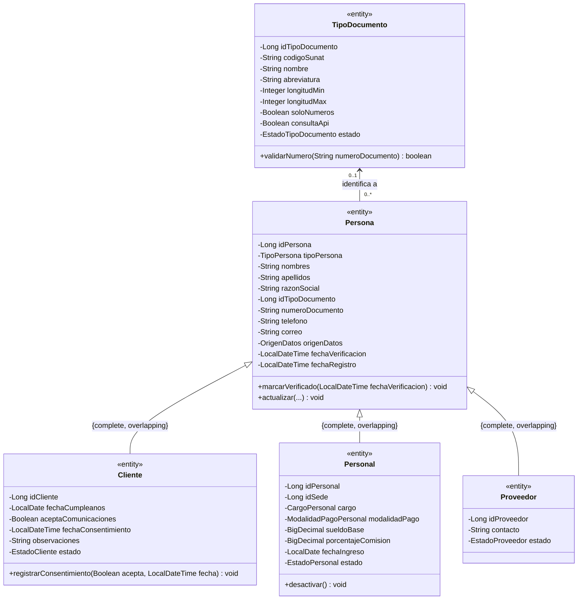

### 3.3 Mapeo de los agregados core

| Agregado | Raíz y tabla | Entidades internas (cascada desde la raíz) | Asociaciones JPA del mismo módulo | IDs de otros módulos | Restricciones que el método valida antes que Oracle |
| --- | --- | --- | --- | --- | --- |
| Venta | `Venta` → VENTA | VentaDetalle, VentaPago, Comprobante y NotaCredito (subtipo JOINED de Comprobante) | NotaCredito extends Comprobante | idSede, idCaja, idCliente, idUsuario, idAtencion, idProducto, idPaquete, idPromocion, idPersonal, idMedioPago, idTransaccion, idTipoDocComprador | CK\_VENTA\_TOTAL, CK\_VENTA\_PAGO\_MONTO, UQ\_VENTA\_PAGO\_ID\_TRANSACCION, CK\_COMPR\_FACTURA, UQ\_COMPROBANTE\_VENTA\_CLASE, CK\_NOTA\_CREDITO\_DEVOLUCION |
| SerieComprobante | `SerieComprobante` → SERIE\_COMPROBANTE | — | — | idSede | UQ\_SERIE\_COMPR\_ACTIVA, CK\_SERIE\_COMPR\_SERIE\_TIPO |
| TransaccionPasarela | `TransaccionPasarela` → TRANSACCION\_PASARELA | — | MedioPago; TransaccionPasarela (origen) | idSede, idCita, idNotaCredito, idUsuario | UQ\_TRANS\_PAS\_CODIGO\_OPERACION, CK\_TRANS\_PAS\_ESTADO, CK\_TRANS\_PAS\_ABONO, CK\_TRANS\_PAS\_COMISION |
| Cita | `Cita` → CITA | — | Cita (citaOrigen) | idCliente, idSede, idPersonal, idRecurso, idVariante, idMedioPago, idCaja, idUsuario | CK\_CITA\_DURACION, CK\_CITA\_FIN, CK\_CITA\_ADELANTO |
| Atencion | `Atencion` → ATENCION | RecomendacionProducto | Cita | idPersonal, idRecurso, idVariante, idProducto, idClientePaquete | CK\_ATENCION\_CLIENTE, CK\_ATENCION\_PAQUETE, CK\_ATENCION\_TIEMPO |
| Cliente | `Cliente` → CLIENTE (subtipo de PERSONA: `@Id idCliente` = idPersona) | SaldoFavorMov | — | idCliente = idPersona (seguridad); idCita, idVenta (en SaldoFavorMov) | CK\_CLIENTE\_ACEPTA\_COM, CK\_SALDO\_FAVOR\_MOV\_ORIGEN; en PERSONA: UQ\_PERSONA\_TELEFONO, CK\_PERSONA\_VERIFICADO |
| Persona | `Persona` → PERSONA (supertipo, módulo seguridad) | — | TipoDocumento | — (los subtipos la referencian por su id) | CK\_PERSONA\_DATOS, CK\_PERSONA\_DOCUMENTO, UQ\_PERSONA\_DOCUMENTO, UQ\_PERSONA\_TELEFONO, CK\_PERSONA\_VERIFICADO |
| Caja | `Caja` → CAJA | CajaEgreso, CajaArqueo | — | idSede, idMedioPago, idUsuario | CK\_CAJA\_CIERRE, CK\_CAJA\_ARQUEO\_DIFERENCIA, CK\_CAJA\_ARQUEO\_OBSERVACION, UQ\_CAJA\_ABIERTA\_SEDE |
| Producto | `Producto` → PRODUCTO | InventarioSede (`@EmbeddedId`), MovimientoKardex | CategoriaProducto | idSede, idDetalleVenta, idDetalleCompra, idAtencion, idUsuario | CK\_PRODUCTO\_PRECIOS, CK\_MOV\_KARDEX\_SALDO |

### 3.4 Ejemplo de mapeo JPA

Fragmento de la jerarquía COMPROBANTE y del subtipo Cliente; los nombres de columna son los del diccionario v5.

```java
@Entity @Table(name = "COMPROBANTE")
@Inheritance(strategy = InheritanceType.JOINED)          // jerarquía COMPROBANTE (v5)
public class Comprobante {
  @Id @GeneratedValue(strategy = GenerationType.IDENTITY)
  @Column(name = "id_comprobante") private Long idComprobante;
  @ManyToOne(fetch = FetchType.LAZY) @JoinColumn(name = "id_venta") private Venta venta;
  @Enumerated(EnumType.STRING) @Column(name = "tipo") private TipoComprobante tipo;   // BOLETA, FACTURA, NC_BOLETA, NC_FACTURA
  @Column(name = "serie", insertable = false, updatable = false) private String serie;   // la asigna Oracle (RN47)
  @Column(name = "numero", insertable = false, updatable = false) private String numero;
  @Column(name = "id_tipo_doc_comprador") private Long idTipoDocComprador;          // TIPO_DOCUMENTO (seguridad): solo el ID
  @Enumerated(EnumType.STRING) @Column(name = "estado_sunat") private EstadoSunat estadoSunat;
}

@Entity @Table(name = "NOTA_CREDITO")
@PrimaryKeyJoinColumn(name = "id_nota_credito")            // PK compartida con COMPROBANTE
public class NotaCredito extends Comprobante {
  @Column(name = "motivo", nullable = false) private String motivo;
  @Column(name = "codigo_motivo", nullable = false) private String codigoMotivo;
  @Enumerated(EnumType.STRING) @Column(name = "forma_devolucion") private FormaDevolucion formaDevolucion;
  @Column(name = "id_usuario_solicita", nullable = false) private Long idUsuarioSolicita;
  @Column(name = "id_usuario_autoriza", nullable = false) private Long idUsuarioAutoriza;
}

@Entity @Table(name = "CLIENTE")                          // subtipo de PERSONA en otro módulo (agenda)
public class Cliente {
  @Id @Column(name = "id_cliente") private Long idCliente;   // = PERSONA.id_persona, sin IDENTITY
  @Column(name = "acepta_comunicaciones") @Convert(converter = SiNoConverter.class) private Boolean aceptaComunicaciones;
  @Column(name = "fecha_consentimiento", nullable = false) private LocalDateTime fechaConsentimiento;
  protected Cliente() { }
  public Cliente(Long idPersona, LocalDate fechaCumpleanos, String observaciones) { this.idCliente = idPersona; /* RF03 */ }
}
```

## Sección 4 · Catálogo de diagramas dinámicos UML

El catálogo tiene 64 diagramas de secuencia en el draw.io (uno por cada caso de uso con realización) y, en este documento, los que completan los escenarios críticos: 2 secuencias de tareas programadas, 1 diagrama de comunicación, 2 de actividades y 4 de estados. Los nombres de los mensajes y de los estados son los métodos y los CHECK de las Secciones 1 y 3.

### 4.1 Diagramas de secuencia

| CUS | Escenario crítico que cubre | Líneas de vida | Mensajes |
| --- | --- | --- | --- |
| CUS18 Cobrar Venta | Venta desde la atención, descuentos y saldo a favor, pago por la pasarela y cierre que «include» CUS19; Oracle marca la atención COBRADA | 15 | 69 |
| CUS07 Registrar Adelanto de Reserva | Adelanto en efectivo, enlace de pago y webhook de Izipay que confirma el adelanto por evento | 18 | 53 |
| CUS02 Registrar Clienta | Consulta del documento en APISPERU, PERSONA verificada y CLIENTE con el mismo id (herencia v5) | 15 | 51 |
| CUS11 Registrar Atención | Atención con cita, sesión de paquete en ATENCION.id\_cliente\_paquete y cita FINALIZADA | 13 | 51 |
| CUS65 Configurar Parámetro del Negocio | Parámetros del negocio y catálogo TIPO\_DOCUMENTO | 11 | 50 |
| CUS19 Emitir Comprobante Electrónico | Consulta de RUC, comprobante con serie y número de Oracle y envío a SUNAT por APISPERU con CDR | 15 | 44 |
| CUS53 Asignar Rol | Rol del usuario y permisos del rol (ROL, PERMISO, ROL\_PERMISO) | 11 | 39 |
| CUS57 Registrar Servicio | Área con su línea y servicio con tipo de recurso, variantes e insumos | 10 | 38 |
| CUS13 Registrar Atención sin Cita | Atención sin cita por AtencionApi y cobro delegado en ServicioVenta | 11 | 35 |
| CUS36 Registrar Personal | Persona NATURAL con DNI o carnet por PersonaApi y PERSONAL con el mismo id, áreas y horario | 9 | 34 |
| CUS42 Calcular Planilla | Asistencias, adelantos y comisiones del mes, y aviso de sueldo bajo la RMV | 11 | 33 |
| CUS58 Actualizar Servicio | Datos, insumos y precio de la variante; el cambio de precio queda en AUDITORIA | 8 | 33 |
| CUS03 Consultar Ficha de Clienta | Ficha con PERSONA, citas, atenciones, paquetes (V\_SESIONES\_PAQUETE) y saldo (V\_SALDO\_FAVOR\_CLIENTE) | 12 | 32 |
| CUS26 Vender Producto | Venta de productos con stock, pasarela y comprobante; Oracle registra la salida de kardex | 12 | 32 |
| CUS45 Cerrar Caja | Esperado por medio con los aprobados de la pasarela, egresos del día y arqueo | 10 | 32 |
| Resto (los otros 49 CUS con realización) | Flujo básico de cada caso | 6–13 | 11–31 |

Las dos tareas programadas no tienen actor humano; las dispara el reloj del servidor. Reenvío de comprobantes pendientes (RF101, RN46):

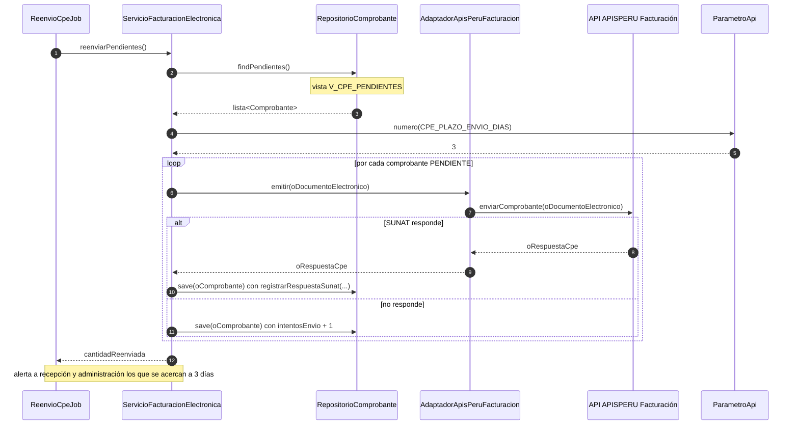

Liquidación de la pasarela antes de conciliar (RF105):

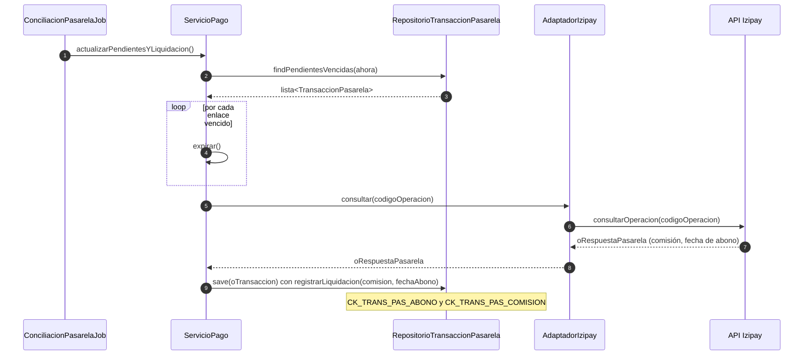

### 4.2 Diagrama de comunicación: cierre de la venta (CUS18 y CUS19)

Los mismos mensajes de la operación de cierre de CUS18 Cobrar Venta, numerados sobre los enlaces entre objetos. El cierre «include» CUS19 Emitir Comprobante Electrónico (mensajes 5 y 9 a 15). Al guardar la venta CERRADA, Oracle (TRG\_VENTA\_EFECTOS) marca la atención COBRADA y registra la salida de los productos (8a); el backend no lo repite. Los descuentos, el saldo a favor y los pagos se aplican antes, en sus propias operaciones de CUS18 (`PATCH /ventas/{idVenta}/descuentos` y `POST /ventas/{idVenta}/pagos`).

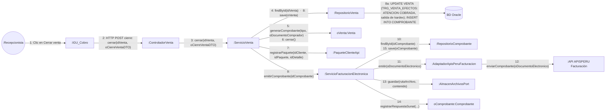

### 4.3 Diagramas de actividades

Cobro de una venta con comprobante electrónico (CUS18 con «include» de CUS19, RF21–RF30, RF98, RF101–RF103):

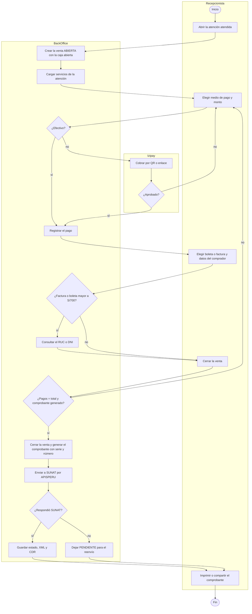

Anulación con devolución (CUS22, con «include» de CUS23 y «extend» de CUS24, RN12, RN32, RN44, RF106):

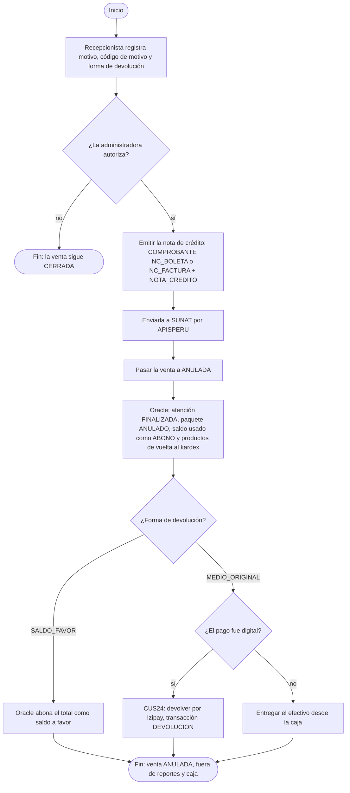

### 4.4 Diagramas de estados

Ciclo de vida de la venta (CK\_VENTA\_ESTADO; RN10–RN12, RN32):

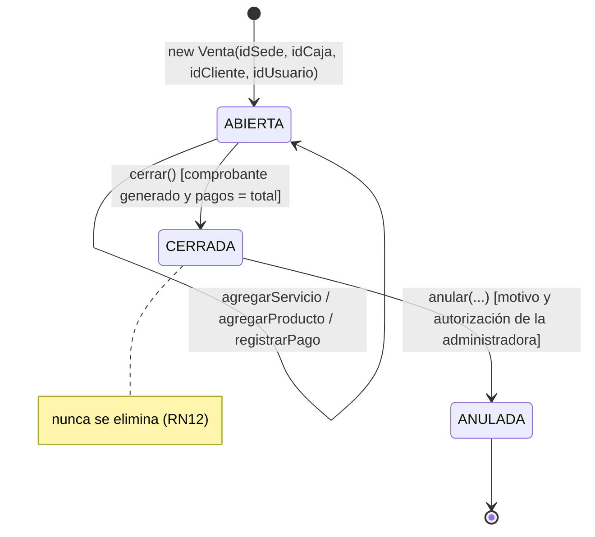

Estado SUNAT del comprobante y de la nota de crédito (CK\_COMPR\_ESTADO\_SUNAT; RN46, RN47):

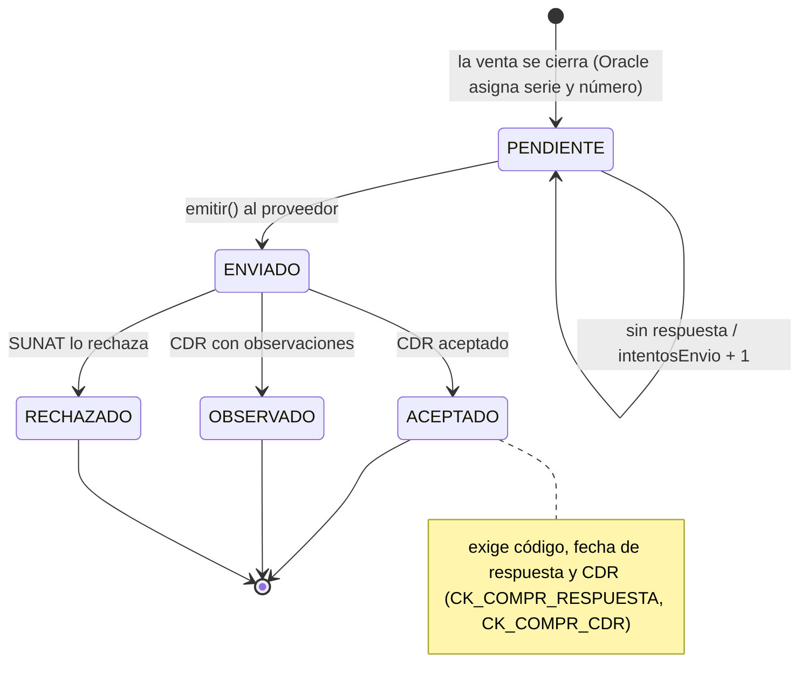

Transacción de la pasarela (CK\_TRANS\_PAS\_ESTADO; RN42, RN44):

```mermaid
stateDiagram-v2
  [*] --> PENDIENTE: cobrar() o generarEnlace()
  PENDIENTE --> APROBADA: aprobar(codigoOperacion) por webhook o consulta
  PENDIENTE --> RECHAZADA: rechazar(mensaje)
  PENDIENTE --> EXPIRADA: expirar() [enlace vencido]
  APROBADA --> ANULADA: anular()
  APROBADA --> APROBADA: registrarLiquidacion(comision, fechaAbono)
  RECHAZADA --> [*]
  EXPIRADA --> [*]
  ANULADA --> [*]
  note right of APROBADA: solo una APROBADA cuenta como pago; una DEVOLUCION es otra transacción con transaccionOrigen
```

Cita (CK\_CITA\_ESTADO; RN02, RN04, RN05):

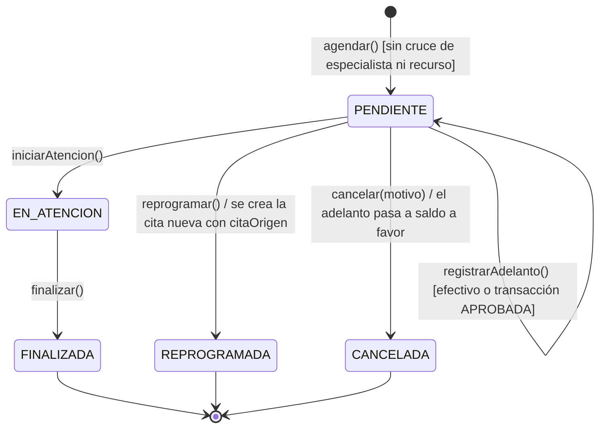

## Sección 5 · Patrones empresariales y contratos de la API REST

Cada caso de uso se implementa con la misma cadena Controller → Service → Repository dentro de su módulo, con DTO en la frontera y agregados DDD en el centro. La API publica 92 operaciones bajo `/api/v1`, todas derivadas de los mensajes HTTP de los diagramas de secuencia; CUS17, CUS27 y CUS67 ya no tienen rutas porque el v5 retiró sus tablas.

### 5.1 Patrones aplicados

| Patrón | Dónde se aplica (clases reales) | Por qué aquí |
| --- | --- | --- |
| MVC en la presentación (RES10) | SPA Angular: componentes `IGU_` (vista), servicios HTTP (modelo del cliente); backend: `ControladorX` | La cátedra lo exige y separa la pantalla de las reglas |
| Controller (REST) | 29 controladores, uno por recurso; reciben DTO, validan formato y devuelven `ResponseEntity` | Un punto de entrada por recurso, sin lógica de negocio |
| Service Layer | `ServicioVenta`, `ServicioCita`, `ServicioPago`… con `@Transactional` | Orquesta el caso de uso y marca el límite de la transacción (1.7) |
| Repository | 37 `RepositorioX extends JpaRepository<X, Long>` | Único acceso a Oracle; consultas con nombre (`findByCodigoOperacion`, `findByDocumentoOTelefono`, `existsById`) |
| DTO + Mapper | `ClienteDTO`, `PersonaDTO`, `CierreVentaDTO`, `EnlacePagoDTO`… + un mapper por módulo (VentaMapper en C4.1 de la Unidad 1) | La API no expone entidades; los costos no salen a roles sin permiso (RN24) |
| Inyección de dependencias | Constructor de cada servicio (los atributos `-repositorioX`, `-pagosApi` de los diagramas de diseño) | Bajo acoplamiento y pruebas con dobles |
| Agregado, entidad y objeto de valor (DDD táctico) | 34 agregados (1.6) y 21 objetos de valor (1.3) | Las invariantes viven en la raíz y Oracle las repite |
| Herencia (generalización) | `Comprobante` ← `NotaCredito` con `@Inheritance(JOINED)`; `Persona` (seguridad) y sus subtipos `Cliente`, `Personal` y `Proveedor` con identidad compartida por `PersonaApi` | Sigue las dos jerarquías EER del diccionario v5 sin repetir columnas; la solapada no puede ser `@Inheritance` (1.6, 3.1) |
| Servicio de dominio | `GestorDisponibilidadAgenda`, `CalculadoraVenta` | Reglas que cruzan agregados (RN02, RN34) o cálculos puros (RN06) |
| Evento de dominio (publicar/suscribir) | `AdelantoAprobado` (pagos) → `ManejadorAdelantoConfirmado` (agenda) | pagos no conoce a agenda; el adelanto se registra en la misma transacción (RN04) |
| Puertos y adaptadores (capa anticorrupción) | `FacturacionElectronicaPort`, `ConsultaDocumentoPort`, `PasarelaPagosPort` con `AdaptadorApisPeruFacturacion`, `AdaptadorApisPeruConsulta`, `AdaptadorIzipay` | Solo hacia los tres externos, como decidió la Unidad 1; cambiar de proveedor toca un adaptador |
| Inversión de dependencias (SPI) | `CajaAbiertaProvider`, `UsuarioActual`, `ParametroApi`, `AuditoriaApi`, `AlmacenArchivosPort`, `HistorialComprasProvider` en `comun` | Evita ciclos entre módulos (Spring Modulith lo verifica) |
| Receptor idempotente | `ControladorNotificacionPasarela` + UQ\_TRANS\_PAS\_CODIGO\_OPERACION | Si Izipay repite el webhook, el pago no se registra dos veces |
| Bloqueo pesimista | `RepositorioCita.findOcupacion` con `@Lock(PESSIMISTIC_WRITE)` | Dos recepcionistas no reservan la misma hora (RN02) |
| Tarea programada con reintento | `ReenvioCpeJob`, `ConciliacionPasarelaJob`, alerta de incidentes de 48 h | Lo que depende de un externo se completa después (RN46, RES30) |
| Auditoría en la base de datos | `TRG_AUD_*` (un trigger por tabla: 54 en el v5 y 56 en el v5.1) + `PKG_SESION` | Registra quién y cuándo en la misma transacción, también lo que no pasa por Java (RN29, RF80); reemplaza al aspecto `@Auditable` desde la It. 2 |
| Efecto en la base de datos | TRG\_VENTA\_EFECTOS, TRG\_COMPRA\_DETALLE\_KARDEX, TRG\_KARDEX\_APLICAR, TRG\_PERSONAL\_DESACTIVAR (script v5) | Lo que Oracle ya hace en la misma transacción no se repite en Java (O-18, O-19) |

### 5.2 Convenciones de la API

- Base `/api/v1`, JSON en UTF-8, montos con 2 decimales en soles, fechas ISO 8601 (`2026-10-22`, `2026-10-22T15:30:00`).
- Autenticación por sesión de Spring Security tras `POST /api/v1/auth/login`; 30 minutos sin actividad cierran la sesión (RF79). El webhook de Izipay no usa sesión: se valida su firma HMAC.
- Los errores salen como `ProblemDetail` (RFC 9457) desde el `ApiExceptionHandler` de `comun`, con el nombre del CONSTRAINT cuando lo detecta Oracle.

| Código | Cuándo | Ejemplo real |
| --- | --- | --- |
| 200 OK | Lectura o cambio de un recurso existente | `POST /ventas/{idVenta}/cierre` |
| 201 Created | Se creó un recurso; cabecera `Location` | `POST /clientes`, `POST /citas` |
| 400 Bad Request | Formato inválido del DTO | Documento que no cumple la longitud o el formato de su tipo (FN\_VALIDAR\_DOCUMENTO, CK\_PERSONA\_NUMERO\_DOC) |
| 401 / 403 | Sin sesión o sin permiso del rol | Recepcionista pide el costo de un producto (RN24) |
| 404 Not Found | El ID no existe | `GET /comprobantes/999/representacion` |
| 409 Conflict | Choque con otro dato | Cruce de cita (RN02), teléfono repetido (UQ\_PERSONA\_TELEFONO), webhook repetido |
| 422 Unprocessable Content | Regla de negocio no cumplida | Cerrar sin comprobante o con pagos ≠ total (RN10, RN11); vender sin stock (RN15) |
| 202 Accepted | El externo no respondió y la operación quedó pendiente | Comprobante PENDIENTE (RN46), consulta del documento que no respondió (RN45) |

### 5.3 Catálogo de operaciones

| CUS | Verbo y ruta | Controlador.método |
| --- | --- | --- |
| CUS01 | GET /api/v1/clientes | ControladorCliente.buscar |
| CUS02, CUS04 | GET /api/v1/clientes/consulta-documento | ControladorCliente.consultarDocumento |
| CUS02 | POST /api/v1/clientes | ControladorCliente.registrar |
| CUS03 | GET /api/v1/clientes/{idCliente} | ControladorCliente.obtenerFicha |
| CUS04 | PUT /api/v1/clientes/{idCliente} | ControladorCliente.actualizar |
| CUS05 | GET /api/v1/citas/disponibilidad | ControladorCita.consultarDisponibilidad |
| CUS05 | POST /api/v1/citas | ControladorCita.agendar |
| CUS06 | POST /api/v1/citas/lista-espera | ControladorCita.registrarEspera |
| CUS07 | POST /api/v1/citas/{idCita}/adelanto | ControladorCita.registrarAdelantoEfectivo |
| CUS07 | POST /api/v1/citas/{idCita}/enlace-adelanto | ControladorCita.generarEnlaceAdelanto |
| CUS07 | POST /api/v1/pagos/notificaciones | ControladorNotificacionPasarela.recibir |
| CUS08 | GET /api/v1/citas/agenda | ControladorCita.consultarAgenda |
| CUS09 | POST /api/v1/citas/{idCita}/reprogramacion | ControladorCita.reprogramar |
| CUS10 | PATCH /api/v1/citas/{idCita}/cancelacion | ControladorCita.cancelar |
| CUS11 | POST /api/v1/atenciones | ControladorAtencion.iniciar |
| CUS11 | PATCH /api/v1/atenciones/{idAtencion}/fin | ControladorAtencion.finalizar |
| CUS12 | GET /api/v1/atenciones/productos | ControladorAtencion.buscarProductos |
| CUS12 | POST /api/v1/atenciones/{idAtencion}/recomendaciones | ControladorAtencion.recomendarProducto |
| CUS13 | GET /api/v1/ventas/rapidas/libres | ControladorVentaRapida.libresAhora |
| CUS13 | POST /api/v1/ventas/rapidas | ControladorVentaRapida.registrarYCobrar |
| CUS14 | GET /api/v1/citas/proximas | ControladorRecordatorio.listarProximas |
| CUS14 | POST /api/v1/citas/{idCita}/recordatorios | ControladorRecordatorio.enviarRecordatorio |
| CUS15 | GET /api/v1/clientes/inactivas | ControladorCliente.listarInactivas |
| CUS16 | GET /api/v1/membresias/planes | ControladorClientePaquete.listarPlanes |
| CUS16 | POST /api/v1/membresias | ControladorClientePaquete.registrarMembresia |
| CUS18 | POST /api/v1/ventas | ControladorVenta.crearDesdeAtencion |
| CUS18 | PATCH /api/v1/ventas/{idVenta}/descuentos | ControladorVenta.aplicarDescuentos |
| CUS18 | POST /api/v1/ventas/{idVenta}/pagos | ControladorVenta.registrarPagos |
| CUS18, CUS19 | POST /api/v1/ventas/{idVenta}/cierre | ControladorVenta.cerrar |
| CUS19 | GET /api/v1/ventas/consulta-ruc/{ruc} | ControladorVenta.consultarRuc |
| CUS20 | GET /api/v1/comprobantes/{idComprobante}/representacion | ControladorComprobante.obtenerRepresentacion |
| CUS20 | GET /api/v1/comprobantes/{idComprobante}/enlace | ControladorComprobante.obtenerEnlace |
| CUS21 | POST /api/v1/proformas | ControladorVenta.armarProforma |
| CUS22, CUS23 | POST /api/v1/ventas/{idVenta}/anulacion | ControladorAnulacion.anular |
| CUS24 | POST /api/v1/ventas/{idVenta}/devolucion | ControladorAnulacion.devolverPago |
| CUS25 | GET /api/v1/ventas/productos | ControladorVenta.buscarProductos |
| CUS26 | POST /api/v1/ventas/productos | ControladorVenta.venderProductos |
| CUS28 | GET /api/v1/proveedores/consulta-ruc/{ruc} | ControladorCompra.consultarRuc |
| CUS28 | POST /api/v1/proveedores | ControladorCompra.registrarProveedor |
| CUS29 | GET /api/v1/productos/en-minimo | ControladorCompra.listarEnMinimo |
| CUS29 | POST /api/v1/requerimientos | ControladorCompra.registrarRequerimiento |
| CUS30 | GET /api/v1/requerimientos/pendientes | ControladorCompra.listarPendientes |
| CUS30 | PATCH /api/v1/requerimientos/{idRequerimiento}/evaluacion | ControladorCompra.evaluar |
| CUS31 | POST /api/v1/compras | ControladorCompra.registrarCompra |
| CUS32 | GET /api/v1/categorias-producto | ControladorProducto.listarCategorias |
| CUS32 | POST /api/v1/productos | ControladorProducto.registrar |
| CUS33 | POST /api/v1/productos/{idProducto}/salidas | ControladorProducto.registrarSalida |
| CUS34 | POST /api/v1/productos/{idProducto}/ajustes | ControladorProducto.registrarAjuste |
| CUS35 | GET /api/v1/productos/{idProducto}/kardex | ControladorProducto.consultarKardex |
| CUS36 | GET /api/v1/personal/consulta-documento | ControladorPersonal.consultarDocumento |
| CUS36 | POST /api/v1/personal | ControladorPersonal.registrar |
| CUS37 | PUT /api/v1/personal/{idPersonal} | ControladorPersonal.actualizar |
| CUS38 | PATCH /api/v1/personal/{idPersonal}/desactivacion | ControladorPersonal.desactivar |
| CUS39 | POST /api/v1/asistencias/marcas | ControladorAsistencia.marcar |
| CUS40 | PATCH /api/v1/asistencias/{idAsistencia} | ControladorAsistencia.corregir |
| CUS41 | POST /api/v1/adelantos | ControladorAdelanto.registrar |
| CUS42 | POST /api/v1/planillas | ControladorPlanilla.calcular |
| CUS43 | GET /api/v1/planillas/{idPlanilla}/recibos/{idPersonal} | ControladorPlanilla.generarRecibo |
| CUS44 | POST /api/v1/cajas | ControladorCaja.abrir |
| CUS45 | GET /api/v1/cajas/{idCaja}/esperado | ControladorCaja.calcularEsperado |
| CUS45 | POST /api/v1/cajas/{idCaja}/cierre | ControladorCaja.cerrar |
| CUS46 | GET /api/v1/cajas/con-diferencia | ControladorCaja.listarConDiferencia |
| CUS46 | PATCH /api/v1/cajas/{idCaja}/revision | ControladorCaja.aprobarCierre |
| CUS47 | POST /api/v1/conciliaciones | ControladorConciliacion.conciliar |
| CUS48 | GET /api/v1/reportes/{tipoReporte} | ControladorReporte.generar |
| CUS49 | GET /api/v1/reportes/{tipoReporte}/exportacion | ControladorReporte.exportar |
| CUS50 | POST /api/v1/auth/login | ControladorAutenticacion.iniciarSesion |
| CUS51 | POST /api/v1/auth/logout | ControladorAutenticacion.cerrarSesion |
| CUS52 | GET /api/v1/roles | ControladorUsuario.listarRoles |
| CUS52 | POST /api/v1/usuarios | ControladorUsuario.registrar |
| CUS53 | PATCH /api/v1/usuarios/{idUsuario}/rol | ControladorUsuario.asignarRol |
| CUS53 | PUT /api/v1/roles/{idRol}/permisos | ControladorUsuario.configurarPermisos |
| CUS54 | PATCH /api/v1/usuarios/{idUsuario}/clave | ControladorUsuario.restablecerClave |
| CUS55 | GET /api/v1/auditoria | ControladorAuditoria.consultar |
| CUS56 | POST /api/v1/incidentes | ControladorIncidente.registrar |
| CUS56 | PATCH /api/v1/incidentes/{idIncidente}/aviso | ControladorIncidente.registrarAviso |
| CUS57 | GET /api/v1/areas | ControladorCatalogo.listarAreas |
| CUS57 | POST /api/v1/areas | ControladorCatalogo.registrarArea |
| CUS57 | POST /api/v1/servicios | ControladorCatalogo.registrarServicio |
| CUS58 | PUT /api/v1/servicios/{idServicio} | ControladorCatalogo.actualizarServicio |
| CUS58 | PATCH /api/v1/servicios/{idServicio}/variantes/{idVariante}/precio | ControladorCatalogo.cambiarPrecio |
| CUS59 | POST /api/v1/paquetes | ControladorCatalogo.registrarPaquete |
| CUS60 | POST /api/v1/promociones | ControladorCatalogo.registrarPromocion |
| CUS61 | POST /api/v1/recursos | ControladorRecurso.registrarRecurso |
| CUS62 | PATCH /api/v1/medios-pago/{idMedioPago} | ControladorMedioPago.configurarMedioPago |
| CUS63 | POST /api/v1/series-comprobante | ControladorSerieComprobante.registrarSerie |
| CUS64 | POST /api/v1/sedes | ControladorSede.registrarSede |
| CUS65 | GET /api/v1/parametros | ControladorParametro.listarParametros |
| CUS65 | PATCH /api/v1/parametros/{codigo} | ControladorParametro.cambiarValor |
| CUS65 | GET /api/v1/tipos-documento | ControladorParametro.listarTiposDocumento |
| CUS65 | PATCH /api/v1/tipos-documento/{idTipoDocumento} | ControladorParametro.configurarTipoDocumento |
| CUS66 | POST /api/v1/categorias-producto | ControladorProducto.registrarCategoria |

Cada edición, desactivación, evaluación o consulta tiene su propio caso de uso y su propia fila: por ejemplo CUS38 `PATCH /personal/{idPersonal}/desactivacion` o CUS30 `PATCH /requerimientos/{idRequerimiento}/evaluacion`. Con el v5 cambian: las consultas de documento (`/clientes/consulta-documento` y `/personal/consulta-documento`, con tipo y número), `GET /areas` y `POST /areas` en lugar de `GET /lineas`, `GET` y `PATCH /tipos-documento` (CUS65), `PUT /roles/{idRol}/permisos` (CUS53), la corrección de asistencia como `PATCH /asistencias/{idAsistencia}` y la proforma, que responde 200 porque no se guarda.

### 5.4 Contratos de las operaciones core

Los campos de los DTO son columnas del diccionario v5 en camelCase; el backend nunca recibe los que asigna Oracle (ID, serie, número, fechas de emisión).

**Crear la venta desde una atención** · `POST /api/v1/ventas` → 201 · 409 si la atención ya está COBRADA · 422 si no hay caja abierta

```json
{ "idAtencion": 1532 }
```

```json
{ "idVenta": 8812, "idSede": 1, "idCaja": 214, "idCliente": 407, "estado": "ABIERTA",
  "detalles": [ { "idDetalle": 20311, "tipoItem": "SERVICIO", "idAtencion": 1532,
                  "cantidad": 1, "precioUnitario": 60.00, "subtotal": 60.00, "idPersonal": 9 } ],
  "subtotal": 60.00, "igv": 0.00, "total": 60.00 }
```

**Registrar pagos** · `POST /api/v1/ventas/{idVenta}/pagos` → 200 · 202 si la transacción quedó PENDIENTE en Izipay · 422 si fue RECHAZADA (no se registra el pago, RF103)

```json
{ "pagos": [ { "idMedioPago": 2, "monto": 40.00, "canal": "QR" },
             { "idMedioPago": 1, "monto": 20.00 } ] }
```

```json
{ "idVenta": 8812, "pagos": [
    { "idPago": 9901, "idMedioPago": 2, "monto": 40.00, "idTransaccion": 5510, "referencia": "IZ-000184322" },
    { "idPago": 9902, "idMedioPago": 1, "monto": 20.00, "idTransaccion": null, "referencia": null } ],
  "pagado": 60.00, "pendiente": 0.00 }
```

**Cerrar la venta y emitir el comprobante** · `POST /api/v1/ventas/{idVenta}/cierre` → 200 con estado SUNAT · 422 si los pagos no suman el total (RN11) o falta el comprador (RN08)

```json
{ "tipo": "FACTURA", "idTipoDocComprador": 3, "nroDocComprador": "20601234567",
  "nombreComprador": "EMPRESA DEMO S.A.C." }
```

```json
{ "idVenta": 8812, "estado": "CERRADA", "total": 60.00,
  "comprobante": { "idComprobante": 7120, "tipo": "FACTURA", "serie": "F001", "numero": "00000125",
                   "fechaEmision": "2026-10-22", "estadoSunat": "ACEPTADO", "codigoRespuesta": "0" } }
```

**Generar el enlace de pago del adelanto** · `POST /api/v1/citas/{idCita}/enlace-adelanto` → 201

```json
{ "adelantoMonto": 50.00, "idMedioPago": 4 }
```

```json
{ "idTransaccion": 5521, "estado": "PENDIENTE", "canal": "LINK",
  "enlacePago": "https://…enlace de Izipay…", "fechaExpiracion": "2026-10-23T15:30:00" }
```

**Notificación de Izipay (webhook)** · `POST /api/v1/pagos/notificaciones` → 200 · 401 si la firma HMAC no es válida · 200 sin cambios si el código de operación ya estaba registrado (idempotente). El cuerpo lo define Izipay y lo traduce `AdaptadorIzipay`; el dominio solo recibe `codigoOperacion` y `estado`.

**Anular la venta** · `POST /api/v1/ventas/{idVenta}/anulacion` → 200 · 403 si quien autoriza no es la administradora (RN32) · 422 si la nota de crédito no se pudo generar. Es CUS22 con «include» de CUS23: primero se emite la nota y luego la venta pasa a ANULADA; Oracle revierte atención, paquete, saldo y kardex. Si el pago fue por la pasarela, la devolución es otra operación: POST /api/v1/ventas/{idVenta}/devolucion (CUS24)

```json
{ "motivo": "Cobro duplicado", "codigoMotivo": "01", "formaDevolucion": "MEDIO_ORIGINAL", "idUsuarioAutoriza": 1 }
```

**Consultar un documento** · `GET /api/v1/clientes/consulta-documento?idTipoDocumento=1&numeroDocumento=…` → 200 con resultado ENCONTRADO · 202 con NO\_ENCONTRADO o ERROR para seguir a mano (RN45) · 422 si el número no cumple su TIPO\_DOCUMENTO o el tipo no se consulta (consulta\_api = N)

```json
{ "idTipoDocumento": 1, "resultado": "ENCONTRADO", "nombres": "…", "apellidos": "…" }
```

Los valores de los ejemplos son ilustrativos; los IDs los asigna Oracle (en TIPO\_DOCUMENTO, 1 = DNI y 3 = RUC según el script 07 del v5). Los nombres devueltos por APISPERU solo completan el formulario: lo que se guarda es la ficha en PERSONA con origen\_datos VERIFICADO y su fecha\_verificacion.

## Sección 6 · Integración empresarial, eventos y servicios de IA

El BackOffice se integra con tres servicios externos (facturación y consulta DNI/RUC de APISPERU, y la pasarela Izipay), cada uno detrás de un puerto y un adaptador; ninguno se llama dentro de una transacción abierta de Oracle y, si no responde, la operación queda PENDIENTE y se completa después (RES30). Entre módulos se usa un evento de dominio de Spring sin broker de mensajería, y lo que Oracle ya hace por trigger no se repite en Java.

### 6.1 Integraciones externas

| Servicio externo | Módulo · puerto · adaptador | Operaciones del puerto | Qué se guarda en Oracle | Si falla | Reglas |
| --- | --- | --- | --- | --- | --- |
| APISPERU · Facturación electrónica (envía a SUNAT; firma con el CDT registrado en su plataforma) | ventas · `FacturacionElectronicaPort` · `AdaptadorApisPeruFacturacion` | `emitir(documento)`, `consultarEstado(serie, numero)` | COMPROBANTE (boletas, facturas y notas de crédito): estado\_sunat, código y descripción de respuesta, hash, rutas del XML y del CDR (archivos en el almacén de archivos) | Queda PENDIENTE; `ReenvioCpeJob` reintenta y alerta los que se acercan a 3 días | RN07, RN10, RN46, RN47, RF27, RF100, RF101 |
| APISPERU · Consulta DNI/RUC | seguridad · `ConsultaDocumentoPort` · `AdaptadorApisPeruConsulta` (lo usa `ServicioPersona`) | `consultar(codigoSunat, numero)` con límite de 3 s, solo si TIPO\_DOCUMENTO.consulta\_api = S (DNI y RUC) | PERSONA.origen\_datos y fecha\_verificacion (sin bitácora: CONSULTA\_DOCUMENTO se retiró en v5) | Resultado ERROR o NO\_ENCONTRADO: la ficha se guarda MANUAL | RN45, RF97–RF99 |
| Izipay · Pasarela de pagos (QR para Yape y Plin, enlace para tarjeta y adelantos, POS cuando haya terminal) | pagos · `PasarelaPagosPort` · `AdaptadorIzipay` + webhook `ControladorNotificacionPasarela` | `crearCobro`, `crearEnlace`, `devolver`, `consultar` | TRANSACCION\_PASARELA: estado, código de operación único, enlace y vencimiento, comisión y fecha de abono; nunca datos de tarjeta | Queda PENDIENTE; `ConciliacionPasarelaJob` consulta y marca EXPIRADA los enlaces vencidos | RN42–RN44, RES08, RES31, RF103–RF106 |
| SUNAT | Solo a través de APISPERU | — | El CDR y el estado de cada comprobante | — | RES11 |
| Correo y WhatsApp | ventas (comprobante); agenda `PuertoNotificacion` (recordatorios, fase 3, en CITA.fecha\_recordatorio) | Enviar la representación impresa con QR por correo o como enlace para compartir | — | El comprobante sigue disponible para imprimir | RF102, RF89 |

**Seguridad de las integraciones.** El token de APISPERU y las llaves de Izipay viven en el almacén de secretos (variables de entorno cifradas); el CDT queda en la plataforma de APISPERU y el sistema no lo guarda. El webhook de Izipay se acepta solo con firma HMAC válida y es idempotente por UQ\_TRANS\_PAS\_CODIGO\_OPERACION. Los accesos fallidos y los webhooks rechazados van al log de aplicación.

**Ambientes.** El mismo código corre en tres ambientes y solo cambian datos y credenciales.

| Ambiente | APISPERU | Izipay | Uso |
| --- | --- | --- | --- |
| local | Modo de pruebas gratuito del equipo | Claves TEST (a pedir a la dueña al empezar el desarrollo) | Desarrollo y pruebas unitarias con dobles de los puertos |
| sandbox | Modo de pruebas | Claves TEST | Pruebas de integración y de aceptación |
| produccion | Cuenta real con el CDT de la empresa registrado | Claves de producción | Operación en el VPS, tras las pruebas de aceptación |

### 6.2 Eventos de dominio y tareas programadas

No se usa un broker de mensajería: el monolito modular publica eventos de Spring entre módulos, Oracle hace en la misma transacción los efectos que el script v5 ya tiene como triggers, y lo que depende de un externo se guarda en Oracle como PENDIENTE para que una tarea programada lo retome. Así no se agregan tablas fuera del diccionario.

| Evento o tarea | Publica o ejecuta | Atiende | Momento | Para qué |
| --- | --- | --- | --- | --- |
| AdelantoAprobado(idCita, idMedioPago, monto) | pagos (ServicioPago.confirmar, CUS07) | agenda (ManejadorAdelantoConfirmado) | Síncrono, en la misma transacción | Registrar el adelanto digital en la cita (RN04, RF104); TRG\_CITA\_ADELANTO lo verifica |
| Efectos de la venta (Oracle, TRG\_VENTA\_EFECTOS) | ventas (Venta.cerrar y Venta.anular) | PKG\_VENTA.al\_cerrar y al\_anular | En la misma transacción (trigger) | Al cerrar: atenciones COBRADAS y salida de productos (RF39); al anular: atención FINALIZADA, paquete ANULADO, saldo a favor y kardex (RN12, RN44) |
| Baja del usuario (Oracle, TRG\_PERSONAL\_DESACTIVAR) | personal (Personal.desactivar, CUS38) | Oracle deja INACTIVO el USUARIO | En la misma transacción (trigger) | Revocar el acceso de la persona desactivada (RF53); reemplaza al evento PersonalDesactivado (O-18) |
| Stock en el mínimo | inventario (Producto.estaEnMinimo; vista V\_STOCK\_ALERTA) | Aviso a la encargada y a la administradora | Después del commit | Alerta de reposición sin frenar la venta (RF47, RN16) |
| ReenvioCpeJob | ventas, tarea programada | ServicioFacturacionElectronica.reenviarPendientes() | Periódica | Reenviar comprobantes y notas de crédito PENDIENTES dentro del plazo CPE\_PLAZO\_ENVIO\_DIAS (RF101, RN46) |
| ConciliacionPasarelaJob | pagos, tarea programada | ServicioPago | Periódica | Confirmar transacciones pendientes, vencer enlaces (LINK\_PAGO\_VIGENCIA\_HORAS) y cargar comisión y abono (RF105) |
| Incidentes sin aviso | seguridad, tarea programada | ServicioIncidente | Periódica | Alertar los incidentes que pasan las 48 horas sin aviso a la autoridad (RF96, RN28) |
| Recordatorio de cita (CUS14, fase 3) | agenda, ServicioRecordatorio | PuertoNotificacion (WhatsApp) | Antes de la hora de la cita | RF89; se guarda la fecha en CITA.fecha\_recordatorio y su falla no afecta la cita |

### 6.3 Servicios de inteligencia artificial

Ninguna de las fuentes (caso, matriz con 107 RF y 35 RNF, diccionario v5) pide un servicio de IA, así que la versión 1 no incluye ninguno y no se diseñan clases, tablas ni endpoints para eso. Si el equipo lo propone después, entraría como un adaptador más detrás de un puerto, igual que APISPERU e Izipay, y primero tendría que agregarse como requerimiento en la matriz.

## Sección 7 · Control de cambios de la Iteración 2

El 08/11/2026 la Iteración 2 adoptó el Diccionario v5.1 (57 tablas, 451 columnas, 131 FK) y las reglas RN48 a RN54. Donde esta tabla contradice las secciones 1 a 6, que documentan el v5, vale esta tabla.

| Tema | En la Unidad 2 (v5) | Desde la Iteración 2 (v5.1) | Trazabilidad |
| --- | --- | --- | --- |
| Auditoría | Aspecto `@Auditable` + `AuditoriaAspect` en Java | 56 triggers `TRG_AUD_*` con el usuario de `PKG_SESION`; Java solo registra el inicio de sesión fallido, el cierre de sesión y el acceso denegado | RN29, RF80, CUS55, CUS58 |
| Ficha de la clienta | `agenda` leía las compras por `VentasConsultaApi` | SPI `HistorialComprasProvider` de `comun`, implementado por `ventas`, para que `agenda` no dependa de `ventas` | CUS03 |
| Anulación de venta | La administradora autorizaba en la misma pantalla (`idUsuarioAutoriza` en `POST /ventas/{idVenta}/anulacion`) | La recepcionista crea una solicitud (`POST /ventas/{idVenta}/solicitudes-anulacion`); la administradora la aprueba, que emite la nota de crédito y anula la venta, o la rechaza con motivo desde su bandeja (`GET /solicitudes-anulacion`, `POST /solicitudes-anulacion/{idSolicitud}/aprobacion`, `POST /solicitudes-anulacion/{idSolicitud}/rechazo`) | RN32, RF32, CUS22, CUS23, tabla SOLICITUD\_ANULACION |
| Devolución de Yape y Plin | Solo por la pasarela | La tarjeta se devuelve por Izipay; Yape y Plin desde la aplicación de la administradora, registrando el número de operación (`POST /ventas/{idVenta}/devolucion-manual`) | RN44, RF106, CUS24 |
| Venta con la caja cerrada | `VENTA.id_usuario_autoriza` | La administradora reabre la caja del día con motivo (`PATCH /cajas/{idCaja}/reapertura`, `Caja.reabrir`); la columna de VENTA queda obsoleta (CK\_VENTA\_AUTORIZA\_OBSOLETA) | RN30, RF66, CUS46, columnas de reapertura en CAJA |
| Consumo de insumos | Salida manual de insumos | Al finalizar la atención se descuenta el consumo estimado (`InventarioApi.registrarConsumoAtencion`); el faltante queda en CONSUMO\_PENDIENTE, que almacén regulariza o descarta (`GET /consumos-pendientes`, `POST /consumos-pendientes/{idConsumo}/regularizacion`, `PATCH /consumos-pendientes/{idConsumo}/descarte`); los insumos van en su unidad mínima | RN17, RN53, RN54, RF46, CUS11, CUS33 |
| Limpieza del recurso | Hasta 30 minutos | De 0 a 10 minutos (`RECURSO.minutos_limpieza`, 10 por defecto); bloquea solo el recurso y la especialista queda libre al terminar; la agenda avanza de 15 en 15 minutos (`AGENDA_PASO_MIN`) | RN03, CUS61, CUS65 |
| Lista de espera | Solo se registraba | La cita se programa desde una entrada de la lista (`idEspera`); la recepcionista ve y descarta entradas (`GET /citas/lista-espera`, `PATCH /citas/lista-espera/{idEspera}/descarte`) | RF09, CUS05, CUS06 |
| Clienta que no se presenta | Solo la cancelación abonaba el adelanto | Se cancela la cita y el adelanto pasa a saldo a favor | RN05, CUS10 |
| Conciliación mensual | `ConciliacionPasarelaJob` consultaba a Izipay la comisión y el abono de cada transacción | La administradora importa el reporte de liquidación del panel de Izipay (`POST /conciliaciones/liquidacion`), justifica cada diferencia (`PATCH /conciliaciones/{id}/items/{idItem}`) y la cierra (`PATCH /conciliaciones/{id}/cierre`), porque Izipay no publica una API de liquidación | CUS47 |
| Avisos | Sin panel; cada aviso vivía en su pantalla | Panel de avisos en Inicio (`GET /avisos`, `ControladorAviso` y `ServicioAviso`; cada módulo aporta sus avisos por `AvisoProvider`) | RF47, RF101, CUS50 |
| Costos | Solo la dueña ve costos | La encargada de almacén ve el costo de lo que compra, no el margen | RN24, RES15 |
| Entrega del comprobante | Enlace público compartido por canal o correo (\`GET /comprobantes/{idComprobante}/enlace\`) | Se abre el programa de correo del equipo con el enlace del comprobante; el sistema no envía correos (`mailto`) | CUS20 |
| Reportes | Previstos para después | CUS48 y CUS49 entran en la Iteración 2, con el módulo nuevo `reportes` | CUS48, CUS49 |

El detalle está en Iteracion\_2\_Cautiva\_Spa.drawio (47 páginas), en la hoja «Cambios v5.1» del diccionario y en las hojas 2, 3 y 6 de la matriz, con las celdas marcadas «Ajustado el 08/11/2026».
